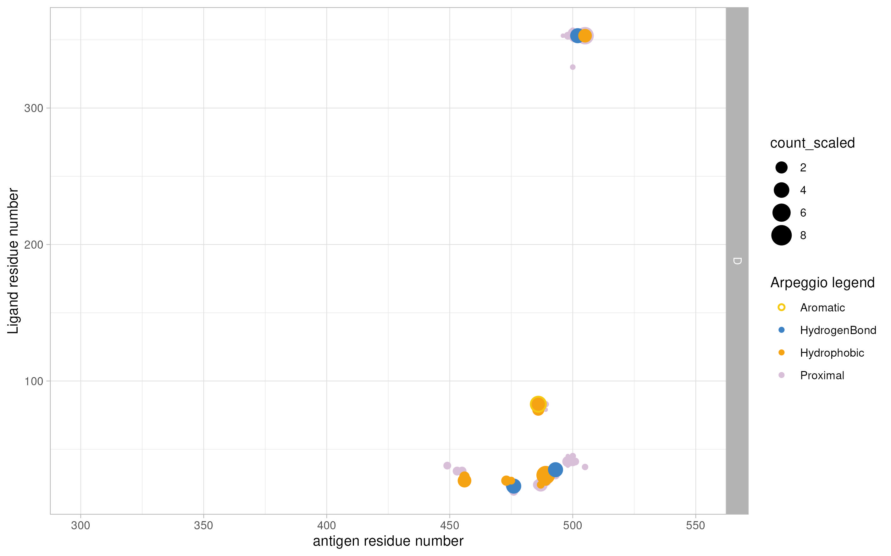
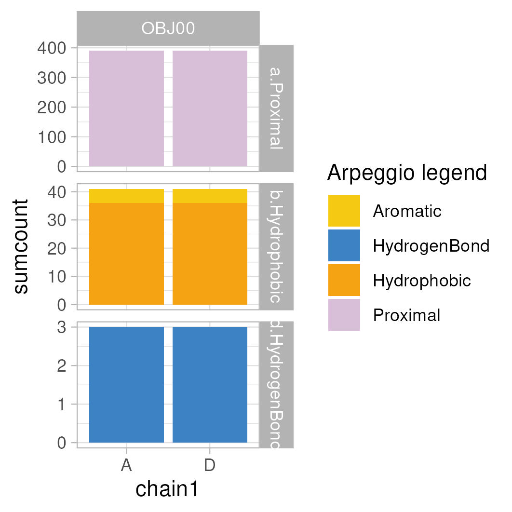
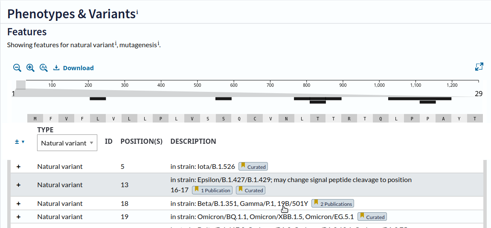

```{r}
library(statip)
library(plotly)
library(tidyjson)
#library(UniprotR)
```

Set the working directory to subfolder. 

```{r}
setwd("/home/rstudio/NBIS_M_Ohlin_2411_interface_analysis_vscoded_mimotopes/NBIS_M_Ohlin_2411_ACE2")
```


```{r}
source("../R/pml_templates.R")
source("../R/shared_config.R")
source("../R/shared_io.R")
source("../R/shared_functions.R")
```

### Additional Functions {.unnumbered}

```{r Functions}
# Shared helpers are sourced from ../R/pml_templates.R
```

## Protein definitions {.unnumbered}

This part is to make some initial definitions.

### To define amino acid types

```{r aa-definition}
project_cfg <- get_project_config("ace2")
AA_tribble <- project_cfg$AA_tribble
AA_singlecode <- project_cfg$AA_singlecode
```

### To define project-specific protein parameters

```{r protein-definition}
# To define the proteins analysed in this script

#RBD00 renamed to OBJ00
#protein_definition <- project_cfg$protein_definition

protein_definition <- tribble(~obj, ~proteinID1, ~proteinID2, ~epitope,
                              "OBJ00", "ACE2", "PDB7A94", "ACE_bound")

```

### To define coloring schemes

```{r color-definitions}
region_colors.tib <- project_cfg$region_colors.tib
region_colors <- project_cfg$region_colors

#https://almerja.com/reading.php?idm=76110 basically Lehninger

```

## PISA analysis of interactions {.unnumbered}

```{r}
ensure_dir("./pisarp_selections")
```

Before continuing here, the relevant PDB file(s) should be processed in PyMol until inclusively `scene_004`.

First select regions of interest in PyMol for analysis using first [PISA](https://www.ebi.ac.uk/pdbe/pisa/) and then [Arpeggio](https://biosig.lab.uq.edu.au/arpeggioweb) webservers.

Selections were exported from PyMOL using [listselection](https://pymolwiki.org/index.php/ListSelection2), saved and copied to the `pisarp_selections` folder.

### Import Arpeggio/PISA selections from PyMol

To read the PyMOL-exported selections.

```{r }
pisasel_filelist.tib <- read_pymol_selection_files("./pisarp_selections/")
```

To generate selections for Arpeggio output to identify interactions of residue with everything else. Alternatively, just use the selection `/D//`

```{r}
ensure_dir("./arp_selections")

arpeggio_exports <- build_arpeggio_selections(
  pisasel_filelist.tib = pisasel_filelist.tib,
  output_dir = "./arp_selections/"
)

arpeggio_selections.tib <- arpeggio_exports$arpeggio_selections.tib
arpeggio_selections.sel <- arpeggio_exports$arpeggio_selections.sel
arpeggio_selections_join <- arpeggio_exports$arpeggio_selections_join

write_arpeggio_selection_files(arpeggio_selections.tib)
```

### PISA analysis

During PyMol analysis, the domains relevant to interface analysis in PISA was saved as PDB file, named `OBJ01_Ab_PISA.pdb`

First create the relevant folder

```{r}
ensure_dir("./data_pisa")
```

#### To import the PISA xml interface data, follow the instructions below, and save the XML files.

Select the XML of the interfacing residues and save this XML as `OBJ01_A_D.xml` in the `data_pisa` folder.

This should be done for all relevant interfaces, in this case for chains `A/D`.

```{r }
pisa_filelist_long_pymol <- read_pisa_interface_data(
  pisa_dir = "./data_pisa",
  arpeggio_selections_join = arpeggio_selections_join
)
```

#### To show the PISA interface table

```{r PISAtable, output=TRUE}
write_pisa_interface_table(
  pisa_filelist_long_pymol = pisa_filelist_long_pymol,
  output_file = "table_pisa.html"
)
```

#### To create the PISA visualization script for PyMol.

Outputs script to use in PyMOL.

```{r}
pisa_filelist_long_sel.pymol <- build_pisa_pymol_scripts(
  pisa_filelist_long_pymol = pisa_filelist_long_pymol,
  template_path = "../pml_templates/alter_b_line.pmltpl",
  output_dir = "./pyscripts/"
)
```

With these PISA visualization scripts exported to `pyscripts`, the analysis continues in PyMol, starting with `scene_005.`

The PyMol session is continued until `scene_010.`

#### PISA focusgroups

To get the PISA-focus groups, CDR and framework regions were defined using IMGT. This can only be run after the PISA analysis and visualization in PyMol where the `listselection` script is used to define focus regions. The txt files comprising the focus regions are copied to the newly created `pisarp_focus` folder.

Furthermore, the `listselection_OBJ00_AGN-ACEb.txt` file has been created previously for another project and was just copied herein.

```{r}
ensure_dir("./pisarp_focus")

```

```{r ImportPISAfocus, echo=FALSE}
pisafocus_filelist.tib <- read_pymol_focus_files("./pisarp_focus/")

pisafocus_exports <- build_focus_selections(
  pisafocus_filelist.tib = pisafocus_filelist.tib,
  output_dir = "./arpisa_focus/"
)

pisafocus_selections.tib <- pisafocus_exports$pisafocus_selections.tib
pisafocus_selections.sel <- pisafocus_exports$pisafocus_selections.sel
pisafocus_selections_join <- pisafocus_exports$pisafocus_selections_join

```

#### To summarizie PISA in boxplots

Optional: the PISA bsa output can be used as reference input for the other two interfaces. 

```{r}
chain_adjustements <- project_cfg$chain_adjustements

ref_pisafocus_selections_join <- pisafocus_selections_join %>% dplyr::filter(., obj == "OBJ00") %>% dplyr::select(., !c("obj"))

noref_pisafocus_selections_join <- pisafocus_selections_join %>% dplyr::filter(., obj != "OBJ00")

pisa_filelist_long_sel <- merge_pisa_focus_regions(
  pisa_filelist_long_pymol = pisa_filelist_long_pymol,
  ref_pisafocus_selections_join = ref_pisafocus_selections_join,
  pisafocus_selections_join = pisafocus_selections_join,
  mode = "ace2"
)

pisa_filelist_long_sel_regionsum <- summarize_pisa_regions(
  pisa_filelist_long_sel = pisa_filelist_long_sel,
  chain_adjustements = chain_adjustements
)

# To plot Rec
pisa_ligand_plot_1.tib <- pisa_filelist_long_sel_regionsum %>% dplyr::filter(., arpeggio == "SPIKE") %>% ggplot(data=.) + geom_col(aes(x=chain, y = bsa_sum, fill = region_col), colour="black", size=0.5, position = position_stack(reverse = TRUE)) +
#scale_fill_gradient2("bsa: Å", midpoint = 80, low="lightblue", mid="blue", high="red", space ="Lab") +
  scale_fill_manual(values = region_colors, drop=FALSE) +
  theme_minimal() +
  theme(panel.grid.major.x = element_blank()) +
  #  scale_x_discrete() +
  #theme(legend.position = "none") +
  scale_y_continuous(minor_breaks = NULL) +
  #scale_x_continuous("bsa: Å", breaks = c(0,250, 500)) +
  coord_cartesian(ylim = c(0,1200)) +
  #geom_text( aes(label = res1AA, y = -5), position = position_dodge(0.9), vjust = 0) +
  facet_grid(obj ~ .)
  #print(molprob_filelistdata_int_sum_ligres_area_sum_plot.tib)
  save_plot_jpeg_ps(pisa_ligand_plot_1.tib, "ggplot_pisa_bsa_1", width = 55, height = 90)

  # To plot Ab1
  pisa_ligand_plot_2_pre.tib <- pisa_filelist_long_sel_regionsum %>% dplyr::filter(., arpeggio == "AB1") 
  pisa_ligand_plot_2.tib <- pisa_ligand_plot_2_pre.tib %>% ggplot(data=.) + geom_col(aes(x=chain, y = bsa_sum, fill = region_col), colour="black", size=0.5) +
#scale_fill_gradient2("bsa: Å", midpoint = 80, low="lightblue", mid="blue", high="red", space ="Lab") +
  scale_fill_manual(values = region_colors, drop=FALSE) +
  theme_minimal() +
      theme(panel.grid.major.x = element_blank()) +

  #scale_x_discrete(breaks=NULL) +
  #theme(legend.position = "none") +
  scale_y_continuous(minor_breaks = NULL) +
  #scale_x_continuous("bsa: Å", breaks = c(0,250, 500)) +
  coord_cartesian(ylim = c(0,1200)) +
  #geom_text( aes(label = res1AA, y = -5), position = position_dodge(0.9), vjust = 0) +
  facet_grid(obj ~ .)
  #print(molprob_filelistdata_int_sum_ligres_area_sum_plot.tib)
  save_plot_jpeg_ps(pisa_ligand_plot_2.tib, "ggplot_pisa_bsa_2", width = 65, height = 90)
  
# To plot bricks of Ab regions
  
  pisa_ligand_plot_3.tib <- pisa_filelist_long_sel_regionsum %>% dplyr::filter(., arpeggio == "AB1") %>% group_by(obj, arpeggio, chain, region_col) %>% mutate(., bsa_split = list(split_value_f(bsa_sum, 50))) %>% unnest(bsa_split) %>% ggplot(data=.) + geom_col(aes(x=region_col, y = unit_value), fill="grey", colour="black", size=0.5) +
#scale_fill_gradient2("bsa: Å", midpoint = 80, low="lightblue", mid="blue", high="red", space ="Lab") +
  scale_fill_manual(values = region_colors, drop=FALSE) +
  theme_minimal() +
      theme(panel.grid.major.x = element_blank()) +

  #scale_x_discrete(breaks=NULL) +
  #theme(legend.position = "none") +
  #scale_y_continuous(minor_breaks = NULL) +
  #scale_x_continuous("bsa: Å", breaks = c(0,250, 500)) +
  coord_cartesian(ylim = c(350,0)) +
  scale_y_reverse(minor_breaks = NULL) +
  #geom_text( aes(label = res1AA, y = -5), position = position_dodge(0.9), vjust = 0) +
  facet_grid(obj ~ chain)
  #print(molprob_filelistdata_int_sum_ligres_area_sum_plot.tib)
  save_plot_jpeg_ps(pisa_ligand_plot_3.tib, "ggplot_pisa_bsa_3", width = 90, height = 180)
```


```{r PisaStats}
pisa_filelist_long_sel_resP.stats <- compute_pisa_region_stats(
  pisa_filelist_long_sel_regionsum = pisa_filelist_long_sel_regionsum
)

write_pisa_stats_table(
  pisa_filelist_long_sel_resP.stats = pisa_filelist_long_sel_resP.stats,
  output_file = "table_pisastats.html"
)

```

## Arpeggio analysis/visualization

### Arpeggio analysis

You can upload the PDB to the server or just use the PDB code, the contents of the respective files in the folder `arp_selections` are uploaded into the respective selection field of the arpeggio server. This is to specify which interactions we are interested in. To analyse the molecular interactions the PDB file is uploaded to [Arpeggio](#0), and all results are downloaded.

Select to analyze the contacts between chains D against everything else.

Download All results, and copy the `contacts` file into the `data_arpeggio` folder and rename the file to `OBJ01_AB1.contacts`.

The Zipped folder also contains a PyMol session file where all interactions are already visualized.

However, I wanted to integrate the interactions within my own PyMol sessions and to visualize key interactions with my own style. Furthermore, the R analysis script creates additional plots that may or may not be useful.

### Tidying Arpeggio interaction fingerprints for custom PyMol visualization and additional plots.

#### To process the Arpeggio output

```{r}
ensure_dir("./data_arpeggio")

```

*This needs to be checked. Define the chain(s) of the Ligand*

```{r}
arpeggio_chain_filter <- tribble(~obj, ~chain1, ~keep,
                                 "OBJ00", "D", "Y")
```

##### Arpeggio filter

```{r}

pdbsum_filelist = list.files(path = "./data_arpeggio", pattern = "*", recursive = TRUE, include.dirs = TRUE, full.names = TRUE)

pdbsum_filelist.tib <- as_tibble(pdbsum_filelist) %>% separate(., value, into = c("folder", "subfolder", "filename"), sep = "\\/", remove = FALSE) %>% separate(., filename, into = c("obj", "filetype"), sep = "_") %>% separate(., filetype, into = c("arpeggio", "filetype")) %>% left_join(., PDBsum_sort_tribble)  %>% mutate(data = purrr::pmap(list(value, named_col), read_tsv_pdbsum_f)) %>% dplyr::mutate(., data_mod = purrr::map(data, ~dplyr::mutate(., across(.cols = !c("id1", "id2", "ENTITIES"), .fns = ~case_when(. >  0 ~ "interaction"))))) %>% dplyr::mutate(., data_long = purrr::map(data_mod, ~pivot_longer(., cols = !c("id1", "id2", "ENTITIES"), values_drop_na = TRUE))) %>% dplyr::mutate(., data_long_id = purrr::map(data_long, ~arpeggio_id_f(.))) %>% dplyr::mutate(., data_long2 = purrr::map(data_long_id, ~analyze_arpeggio_f(.)))  %>% dplyr::mutate(., data_long3 = purrr::map(data_long2, ~arpeggio_sort_f(.))) %>% dplyr::mutate(., data_boxplot = purrr::map(data_long3, ~arpeggio_sum_f(.))) 

arpfeature_tib <- tribble(~ranktype, ~name, ~arpclass,
                       "distance", "WeakPolar", "weak",
                       "distance", "weakHydrogenBond", "weak")

arpeggio_exports <- process_arpeggio_pipeline(
  pdbsum_filelist.tib = pdbsum_filelist.tib,
  PDBsum_sort_tribble = PDBsum_sort_tribble,
  arpfeature_tib = arpfeature_tib,
  arpeggio_chain_filter = arpeggio_chain_filter
)

pdbsum_filelist_levels.tib <- arpeggio_exports$pdbsum_filelist_levels.tib
pdbsum_filelist_atomlevel.tib <- arpeggio_exports$pdbsum_filelist_atomlevel.tib
pdbsum_filelist_reslevel.tib <- arpeggio_exports$pdbsum_filelist_reslevel.tib
pdbsum_filelist_liglevel.tib <- arpeggio_exports$pdbsum_filelist_liglevel.tib
feature_contacts.tib <- arpeggio_exports$feature_contacts.tib
feature_contacts_residue.tib <- arpeggio_exports$feature_contacts_residue.tib
feature_contacts_contact.map <- arpeggio_exports$feature_contacts_contact.map

```

#### To summarize the Arpeggio interactions

```{r}
# Load YRB colors and Arpeggio color tribble from shared config
yrb <- get_yrb_colors()
arpeggio_sort_tribble <- get_arpeggio_color_tribble()

# Extract named vectors for coloring
arpeggio_coltribble <- arpeggio_sort_tribble
arpeggio_coltribble_col <- arpeggio_coltribble %>% dplyr::select(PIC_type, PIC_typecolor) %>% deframe(.)
arpeggio_coltribble_col_all <- arpeggio_coltribble %>% dplyr::select(PIC_type, PIC_gencolor) %>% deframe(.)

arpeggio_AA_tribble <- arpeggio_coltribble %>% right_join(., AA_tribble) %>% dplyr::mutate(AA_typecolor = case_when(AAcolor == "NEG" ~ yrb$yrb_red, TRUE ~ PIC_typecolor))

arpeggio_AA_tribble_col <- arpeggio_AA_tribble %>% dplyr::select(resaa, AA_typecolor) %>% deframe(.)

pdbsum_filelist_preboxplot.tib <- pdbsum_filelist_liglevel.tib

```

To create res-level stats table

```{r}
#%>% dplyr::mutate(., number1 = as.numeric(number1))

pdbsum_filelist_preboxplot.stats <- pdbsum_filelist_preboxplot.tib %>% dplyr::filter(., !grepl('Proximal|weak|Weak', name))

write_datatable_html(
  data = pdbsum_filelist_preboxplot.stats,
  output_file = "table_arp_resstats.html"
)


```

#### To visualize the Arpeggio molecular interaction fingerprints (MIF)

##### MIF interactions ranked

**Note:** Compared to the standard Arpeggio output I have initially applied residue-level interaction ranking, according to the ranking table below. Thus, an ionic contact supersedes a hydrogen bond, or an aromatic supersedes hydrophobic. This resulted in a slightly cleaner PyMol Figure. Also I have focused on hydrophobic interactions and hydrogen bonds for the visualization. These interactions are typically the dominant forces governing protein-protein interactions.

```{r}
#%>% dplyr::mutate(., number1 = as.numeric(number1))

PDBsum_rank_tribble.stats <- PDBsum_rank_tribble %>% dplyr::filter(., ranktype != "distance") %>% dplyr::arrange(., ranktype, rank)

write_datatable_html(
  data = PDBsum_rank_tribble.stats,
  output_file = "table_arp_rank.html"
)


```

##### Per residue MIF counting plot

```{r}
arpeggio_assign_color <- pdbsum_filelist_preboxplot.tib %>% dplyr::group_by(., name) %>% dplyr::summarize() %>% dplyr::mutate(., PIC_type = case_when(name == "Carbonyl" ~ "Other", name == "HydrogenBond" ~ "Hydrogen", name == "Polar" ~ "Hydrogen", name == "Proximal" ~ "Other", name == "VdW" ~ "Other", name == "vdW_Clash" ~ "Other", name == "weakHydrogenBond" ~ "Other", name == "WeakPolar" ~ "Other", TRUE ~ name)) %>% left_join(., arpeggio_coltribble) %>% dplyr::mutate(., priority = case_when(name == "Proximal" ~ "a", name == "Hydrophobic" ~ "b", name == "Aromatic" ~ "c", name == "HydrogenBond" ~ "d", name == "Ionic" ~ "e", name == "Polar" ~ "f", name == "weakHydrogenBond" ~ "g", name == "WeakPolar" ~ "h", name == "Carbonyl" ~ "i", name == "WeakPolar" ~ "j", TRUE ~ "k")) %>% unite(., col = "name_priority", c("priority", "name"), sep = ".", remove = FALSE) %>% dplyr::mutate(., facetPIC = case_when(name_priority == "c.Aromatic" ~ "b.Hydrophobic", name_priority == "e.Ionic" ~ "d.HydrogenBond", TRUE ~ name_priority)) %>% dplyr::mutate(., filled = case_when(PIC_type == "Aromatic" ~ "N", PIC_type == "Other" ~ "Y", PIC_type == "Ionic" & name == "Ionic" ~ "N", PIC_type == "Ionic" & name == "HydrogenBond" ~ "Y", PIC_type == "Hydrophobic" ~ "Y", PIC_type == "Hydrogen" ~ "Y"))

arpeggio_assign_color_col <- arpeggio_assign_color %>% dplyr::select(., name=PIC_type, PIC_typecolor) %>% deframe(.)
arpeggio_assign_color_col_res <- arpeggio_assign_color %>% dplyr::select(., name, PIC_typecolor) %>% deframe(.)
  
# new plot (interactions not ranked), in accordance with Arpeggio output
# priority filters out only feature contacts without weak, carbonyl or polar contacts. 

feature_contacts_residue_contactplot_pre.tib <- feature_contacts_contact.map %>% dplyr::filter(., arpclass == "strong")  %>% dplyr::mutate(., name_cor = case_when(name == "VdW" ~ "Proximal", name == "vdW_Clash" ~ "Proximal", TRUE ~ name)) %>% dplyr::select(., !c("name")) %>% dplyr::mutate(., name = name_cor) %>% dplyr::mutate(., number1 = as.numeric(number1), number2 = as.numeric(number2))  %>% dplyr::mutate(., scaling = case_when(name == "Proximal" ~ 0.2, name == "HydrogenBond" ~ 5, name == "Ionic" ~ 2, TRUE ~ 1)) %>% dplyr::mutate(., count_scaled = sumcount*scaling) %>% left_join(., arpeggio_assign_color) %>% dplyr::filter(., priority < "f") %>% dplyr::select(., !contains("empty"))

feature_contacts_residue_contactplot.tib <- feature_contacts_residue_contactplot_pre.tib %>% ggplot() + 
  geom_point(data = . %>% dplyr::filter(., name == "Proximal", filled == "Y"), aes(x=number2, y = number1, color=name, size = count_scaled)) +
  geom_point(data = . %>% dplyr::filter(., name != "Proximal", filled == "Y"), aes(x=number2, y = number1, color=name, size = count_scaled)) +
  geom_point(data = . %>% dplyr::filter(., name != "Proximal", filled == "N"), aes(x=number2, y = number1, color=name, size = count_scaled), shape = 1, stroke = 1) +
  scale_size_area() +
  scale_x_continuous("antigen residue number") +
  scale_y_continuous("Ligand residue number") +
  coord_cartesian(xlim = c(300, 550)) +
  #coord_cartesian(xlim = c(0,15)) +
  scale_color_manual(values = arpeggio_assign_color_col_res, "Arpeggio legend") +
  theme_light() +
  #theme(legend.position = "none") +
  facet_grid(chain1 ~ ., scales = "free_x")
#print(filelistdata_molprob_int_sum_ligres2_boxplot.tib)
  save_plot_jpeg_ps(feature_contacts_residue_contactplot.tib, "ggplot_feature_contacts_residue_contmap", width = 240, height = 150)
  
feature_contacts_residue_contactplot.plotly <- write_ggplotly_html(
  plot_obj = feature_contacts_residue_contactplot.tib,
  output_file = "feature_contacts_residue_contactplot.html"
)
  
```

———————————————————————————————————————————

 Counts are scaled for visual purposes. Otherwise hydrophobic interactions become dominant. Following scales were applied: Hb: 5, Ionic: 2 , Proximal - 0.2; Hydrophobic: 1

Go to the [interactive plot](feature_contacts_residue_contactplot.html) and hover over the points to find interacting residue pairs.

———————————————————————————————————————————

##### MIF per chain boxplot

```{r}

# new plot (interactions not ranked), in accordance with Arpeggio output

feature_contacts_boxplot_sum_pre.tib <- feature_contacts.tib %>% dplyr::mutate(., scaling = case_when(name == "Proximal" ~ 0.2, TRUE ~ 1)) %>% dplyr::mutate(., count_scaled = sumcount*scaling) %>% dplyr::group_by(., obj, arpeggio, chain1, name) %>% dplyr::summarize(., sumcount=sum(sumcount)) %>% left_join(., arpeggio_assign_color) %>% dplyr::filter(., priority < "f") %>% dplyr::select(., !contains("empty")) 

feature_contacts_boxplot_sum.tib <- feature_contacts_boxplot_sum_pre.tib %>% ggplot(data = ., aes(x=chain1, y = sumcount, colour=PIC_type), fill=NA, linewidth=1, position="identity") + 
  geom_col(data = . %>% dplyr::filter(., filled == "Y"), aes(x=chain1, y = sumcount, fill=PIC_type), colour = "black", linewidth=0.5, position="identity") +
  geom_col(data = . %>% dplyr::filter(., filled == "N"), aes(x=chain1, y = sumcount, colour=PIC_type), fill=NA, linewidth=1, position="identity") +
  scale_fill_manual(values = arpeggio_assign_color_col, "Arpeggio legend") +
  scale_colour_manual(values = arpeggio_assign_color_col, "Arpeggio legend") +
  theme_light() +
  #theme(legend.position = "none") +
  facet_grid(facetPIC ~ obj, scales = "free_y")
#print(filelistdata_molprob_int_sum_ligres2_boxplot.tib)
  save_plot_jpeg_ps(feature_contacts_boxplot_sum.tib, "feature_contacts_boxplot_sum", width = 90, height = 90)

```

———————————————————————————————————————————

{width="307"} The numbers should add up and correspond to the numbers shown in the Arpeggio result.

———————————————————————————————————————————

##### To visualize in PyMol

Note: Arepeggio also outputs a PyMol session file with all interactions to which you can turn if you suspect other interactions, additional to hydrogen bonds and hydrophobic contacts, to contribute crucially to the interface.

```{r}
arpeggio_object.trib <- tribble(~obj_arpeggio, ~obj_new,
                           "OBJ00_AB1", "OBJ00_ARP"
                           )

arpeggio_pymol_exports <- build_arpeggio_pymol_exports(
  pdbsum_filelist_atomlevel.tib = pdbsum_filelist_atomlevel.tib,
  generate_contacts_fn = generate_arpeggio_contacts_f,
  tune_contacts_fn = tune_arpeggio_contacts_f,
  output_dir = "./pyscripts/"
)

pdbsum_filelist_atomlevel_pre.pyscript <- arpeggio_pymol_exports$pdbsum_filelist_atomlevel_pre.pyscript
pdbsum_filelist_atomlevel.pyscript <- arpeggio_pymol_exports$pdbsum_filelist_atomlevel.pyscript
pdbsum_filelist_tune.pyscript <- arpeggio_pymol_exports$pdbsum_filelist_tune.pyscript

```

#### To show Arpeggio interface table

```{r output=TRUE}
pdbsum_filelist_atomlevel.stats <- pdbsum_filelist_atomlevel.tib %>% dplyr::select(., obj_arpeggio, id1, id2, number1, number2, name, name_cor) %>% dplyr::filter(., name_cor != "Proximal")

write_datatable_html(
  data = pdbsum_filelist_atomlevel.stats,
  output_file = "table_arp_stats.html"
)
```

The the PyMol script can be continued to scene_012 in order to visualize the hydrophobic and H bond contacts on the focus region.

# Natural variants (Uniprot JSON) visualization

## Download data from Uniprot
{width="307"} Select the natural variants and download the json file.

## Import JSON
```{r}
uniprot_variant_tribble <- tribble(~filename,~obj_pymol, ~chain, ~Ab,
  "P0DTC2.json", "OBJ00_escape", "A", "Ab117",
  "P0DTC2.json", "OBJ00_escape", "A", "Ab321"
)

ensure_dir("./data_uniprot")

uniprotvariants_filelist = list.files(path = "./data_uniprot", pattern = "*", recursive = TRUE, include.dirs = TRUE, full.names = TRUE)

read_uniprotvariants_f <- function(data_in) {
  data_json <- tidyjson::read_json(data_in, format="json") 
  return(data_json)
}

process_json_variants_f <- function(json_in) {
  json_features <- json_in %>% enter_object(features) %>% gather_array
  json_obj <- json_features$..JSON %>% gather_object()
  json_tibble <- json_obj %>% dplyr::mutate(., value=..JSON) %>% as_tibble() %>% pivot_wider() %>% unnest(., c(type, description, featureId)) %>% unnest_wider(., col="location") %>% unnest_longer(., c(start, end)) %>% pivot_wider(., names_from=c("start_id", "end_id"), values_from=c("start", "end")) %>% unnest(., c(start_value_value, start_modifier_modifier, end_value_value, end_modifier_modifier)) %>% unnest_wider(., alternativeSequence) %>% unnest_longer(., alternativeSequences) %>% dplyr::select(., !c(featureId)) %>% dplyr::mutate(., start_end = paste(start_value_value, end_value_value, sep=":")) %>% dplyr::select(., !c("start_modifier_modifier", "end_modifier_modifier", "end_value_value"))
  #json_features_extract <- json_features[[1]]$..JSON[[1]]$features 
  #json_resi <- json_type$json_spread[[1]]$..JSON[[2]]$start
  return(json_tibble)
}

uniprotvariants_list.tib <- as_tibble(uniprotvariants_filelist) %>% separate(., value, into = c("folder", "subfolder", "filename"), sep = "\\/", remove = FALSE)

uniprotvariants_list_json.tib <- uniprotvariants_list.tib %>% left_join(., uniprot_variant_tribble) %>% dplyr::mutate(., data = purrr::map(value, ~read_uniprotvariants_f(.))) %>% dplyr::mutate(., json_out = purrr::map(data, ~process_json_variants_f(.))) 

```

### specific to Ab tested spike variants
NOTE: This analysis can yield ambiguous status for certain residues, e.g. can be simultaneously in two groups which may be problematic for coloring. To solve this problem, I have added a correction in the pymol script, i.e.
```
select OBJ00_escapeAb321_neg_pos, OBJ00_escapeAb321_neg and OBJ00_escapeAb321_pos
cmd.color_deep("cyan", 'OBJ00_escapeAb321_neg_pos', 0)
```

```{r}
# XBB.1.16 similar to XBB.1.5 (https://www.gavi.org/vaccineswork/arcturus-who-upgrades-xbb116-covid-19-variant-interest)
# B.1.1.529 is basically BA.1 https://pmc.ncbi.nlm.nih.gov/articles/PMC9376347/

Ab_spike_variant_checker_f <- function(tib_in, Ab) {
  if (Ab=="Ab117") {
    neg_string <- "Beta|Gamma|Omicron/BA.1[,[:space:]]|Omicron/BA.2[,[:space:]]|Omicron/BA.2.75[,[:space:]]|Omicron/XBB.1.5[,[:space:]]"
    pos_string <- "Alpha|Delta|Kappa"
  }
  else if (Ab=="Ab321") {
    neg_string <- "Omicron/XBB.1.5[,[:space:]]|Omicron/BA.1[,[:space:]]"
    pos_string <- "Alpha|Delta|Kappa|Beta|Gamma"
  }
  else
  {
    neg_string <- "Omicron"
    pos_string <- "Alpha"
  }
  tib_out <- tib_in %>% dplyr::filter(., type == "Natural variant") %>% dplyr::mutate(., Alpha=str_extract(description, "Alpha"), Beta=str_extract(description,"Beta"), Gamma=str_extract(description,"Gamma"), Delta=str_extract(description,"Delta"), Epsilon=str_extract(description,"Epsilon"), Iota=str_extract(description,"Iota"), Eta=str_extract(description,"Eta"), Lambda=str_extract(description,"Lambda"), Mu=str_extract(description,"Mu"), Omicron=str_extract(description,"Omicron"), Kappa=str_extract(description,"Kappa"), Theta=str_extract(description,"Theta")) %>% unite(., spike_variants, c("Alpha", "Beta", "Gamma", "Delta", "Epsilon", "Iota","Eta","Lambda", "Omicron", "Mu", "Kappa", "Theta"), sep="_", na.rm = TRUE) %>% dplyr::mutate(., Ab_tested_pos=str_detect(description, pos_string), Ab_tested_neg=str_detect(description, neg_string)) %>% dplyr::mutate(., Ab_tested_pos=recode_values(as.character(Ab_tested_pos), "TRUE" ~ "pos"), Ab_tested_neg=recode_values(as.character(Ab_tested_neg), "TRUE" ~ "neg")) %>% unite(., Ab_tested, c("Ab_tested_pos", "Ab_tested_neg"), remove = FALSE, na.rm = TRUE) %>% dplyr::mutate(., Ab_tested=na_if(Ab_tested, "") ) %>% drop_na(., Ab_tested) 
  return(tib_out)
  
}

uniprot_pymol_f <- function(data_in){
  data_out <- data_in %>% dplyr::select(., start_value_value, Ab_tested) %>% dplyr::mutate(., before = "resi") %>% unite(., residues, c("before", "start_value_value"), sep=" ") %>% nest(., residues) %>% dplyr::mutate(., data_conc = purrr::map(data, ~dplyr::summarise(., residues_conc = str_flatten(residues, collapse = " or ")))) %>% dplyr::select(., !c("data")) %>% unnest(., data_conc)
  return(data_out)
}

uniprotvariants_list_json_spike.tib <- uniprotvariants_list_json.tib %>% dplyr::mutate(., Ab_tested = purrr::pmap(list(json_out, Ab), Ab_spike_variant_checker_f)) 

uniprotvariants_list_json_spike_pymol.tib <- uniprotvariants_list_json_spike.tib %>% dplyr::select(., obj_pymol, Ab, chain, Ab_tested) %>% dplyr::mutate(., spike_residues = purrr::map(Ab_tested, ~uniprot_pymol_f(.))) %>% dplyr::select(., !c("Ab_tested")) %>% unnest(., spike_residues) %>% dplyr::mutate(., cmd = paste("select ", obj_pymol, Ab, "_", Ab_tested, ", ", obj_pymol, Ab, " and chain ", chain, " and (", residues_conc, ")", sep = "")) %>% dplyr::select(., !c("Ab_tested", "residues_conc", "chain")) %>% nest(., .by=c(obj_pymol, Ab), .key="cmd") %>% dplyr::mutate(., filename = paste("./pyscripts/", obj_pymol, Ab, ".pml", sep=""))

pwalk(list(uniprotvariants_list_json_spike_pymol.tib$cmd, uniprotvariants_list_json_spike_pymol.tib$filename), write_csv_pymol_f)

```
### HTML table of variants

```{r}
uniprotvariants_list_json_spike.html <- uniprotvariants_list_json_spike.tib %>% dplyr::select(., Ab, Ab_tested) %>% unnest(., Ab_tested) %>% dplyr::select(., Ab, resi = start_value_value, wt = originalSequence, mut = alternativeSequences, spike_variants, Ab_tested_pos, Ab_tested_neg)

write_datatable_html(
  data = uniprotvariants_list_json_spike.html,
  output_file = "uniprotvariants_list_json_spike.html"
)
```


# Export some plots for combining them.

```{r}
saveRDS(pisa_ligand_plot_2_pre.tib, file="./pisa_ligand_plot_2_pre.rds")
saveRDS(feature_contacts_boxplot_sum_pre.tib, file="./feature_contacts_boxplot_sum_pre.rds")
saveRDS(feature_contacts_residue_contactplot_pre.tib, file="./feature_contacts_residue_contactplot_pre.rds")

# specific for referene
saveRDS(ref_pisafocus_selections_join, "./ref_pisafocus_selections_join.rds")

```

# Additional PyMol script content

The PyMol script `ACE2.pml` comprises additional cmds that were used to create the Figures shown in the ms.

The `echo: false` option disables the printing of code (only output is displayed).
