# Custom visualization of Ab/antigen interactions by tidying PISA and Arpeggio outputs in R and PyMol

## Introduction {.unnumbered}

This is an auxiliary R script used to analyse the Ab321/RBD interaction. In principle, the script can be adapted to other interaction interfaces. The related PyMol script was tested with PyMol 2.5.0 and is run scene-wise by copying and pasting the code into the PyMol terminal. Further instructions are also given in the PyMol script. This analysis was used for Figure 3 of the manuscript.

### IMGT numbering of Abs

Before analyzing Ab STRUCTUREs, I would recommend to get the FR and CDR definitions, and to renumber the residues following IMGT standards. Therefore, analyze the relevant sequence using the [IMGT tool](https://www.imgt.org/3DSTRUCTURE-DB/cgi/DomainGapAlign.cgi).

Then re-number the Ab residues. PyMol can also be used for that purpose.

### Loading libraries required for the analysis

These libraries are required for the R analysis of PISA and Arpeggio outputs.

```{r}
library(tidyverse)
library(xml2)
library(DT)
library(vroom)
library(ggsci)
library(kableExtra)
library(ggforce)
library(egg)
library(ggpubr)
library(datapasta)
library(officer)
library(formattable)
library(bio3d)
library(statip)
library(plotly)
#library(UniprotR)
```

Set the working directory to subfolder

```{r}
setwd("./NBIS_M_Ohlin_2411_Ab321")
```

### Additional Functions {.unnumbered}

```{r Functions}
write_csv_pymol_f <- function(data, pathname){
  df_out <- write_csv(x=data, file = pathname, col_names = FALSE, quote = "none")
  return(df_out)
}

```

## Protein definitions {.unnumbered}

This part is to make some initial definitions.

### To define amino acid types

```{r aa-definition}
AA_tribble <- tribble(~resaa, ~resa, ~PIC_type, ~AAcolor,
               "GLY", "G", "Hydrophobic", "NPA", #non-polar aliphatic
               "ALA", "A", "Hydrophobic", "NPA",
               "PRO", "P", "Hydrophobic", "NPA",
               "VAL", "V", "Hydrophobic", "NPA",
               "LEU", "L", "Hydrophobic", "NPA",
               "ILE", "I", "Hydrophobic", "NPA",
               "MET", "M", "Hydrophobic", "NPA",
               "PHE", "F", "Aromatic", "NPP", #non-polar PHI (aromatic)
               "TYR", "Y", "Aromatic", "NPP",
               "TRP", "W", "Aromatic", "NPP",
               "SER", "S", "HydrogenBond", "PU", # polar uncharged
               "THR", "T", "HydrogenBond", "PU",
               "CYS", "C", "HydrogenBond", "PU",
               "ASN", "N", "HydrogenBond", "PU",
               "GLN", "Q", "HydrogenBond", "PU",
               "LYS", "K", "Ionic", "POS",
               "ARG", "R", "Ionic","POS",
               "HIS", "H", "Ionic","POS",
               "ASP", "D", "Ionic", "NEG",
               "GLU", "E", "Ionic", "NEG") 

AA_singlecode <- AA_tribble %>% dplyr::select(., resaa, resa)
```

### To define project-specific protein parameters

```{r protein-definition}
# To define the proteins analysed in this script

#RBD00 renamed to OBJ00

protein_definition <- tribble(~obj, ~proteinID1, ~proteinID2, ~epitope,
                              "OBJ00", "ACE2", "PDB7A94", "ACE_bound",
                              "OBJ01", "Ab321", "PDBXXXX", "Ab321_bound")
```

### To define coloring schemes

```{r color-definitions}
#region_colors
region_colors.tib <- tribble(~name, ~value,
                        "CDR1", "#FFFF8F",
                        "CDR2", "#FBC97D",
                        "CDR3", "#ECB1CD",
                        #"Sa", "#00FAFA",
                        #"Sb", "#0000D4",
                        "ACE", "#0035D6",
                        #"Ca2", "#E07B21",
                        #"Cb", "#E472E4",
                        "other", "#FFFFFF",
                        "SPIKE", "#FFFFFF",
                        "FR", "#96D096",
                        "AB1", "#96D096")

region_colors <- region_colors.tib %>% deframe()

#https://almerja.com/reading.php?idm=76110 basically Lehninger
```

## PISA analysis of interactions {.unnumbered}

```{r}
if (!dir.exists("./pisarp_selections")) {
  dir.create("./pisarp_selections")
}
```

Before continuing here, the relevant PDB file(s) should be processed in PyMol until inclusively `scene_004`.

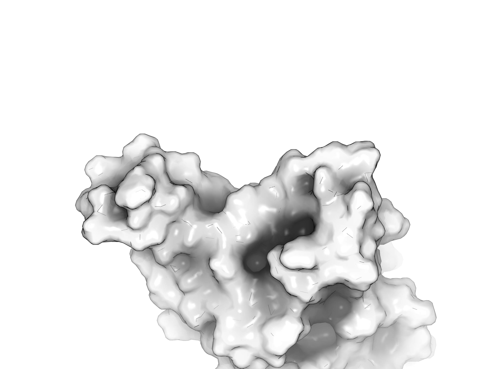

——————————————————————————————————————————— First select regions of interest in PyMol for analysis using first [PISA](https://www.ebi.ac.uk/pdbe/pisa/) and then [Arpeggio](https://biosig.lab.uq.edu.au/arpeggioweb) webservers.

Selections were exported from PyMOL using [listselection](https://pymolwiki.org/index.php/ListSelection2), saved and copied to the `pisarp_selections` folder.

### Import Arpeggio/PISA selections from PyMol

To read the PyMOL-exported selections.

```{r }
pisasel_filelist = list.files(path = "./pisarp_selections/", pattern = "*.txt")
pisasel_filelist.dat <- data.frame(folder = c(rep("./pisarp_selections/", length(pisasel_filelist))), files = pisasel_filelist)
pisasel_filelist.dat$read <- paste(pisasel_filelist.dat$folder, pisasel_filelist.dat$files, sep = "")
pisasel_filelist.tib <- as_tibble(pisasel_filelist.dat)

pisasel_filelist.tib <- pisasel_filelist.tib %>% dplyr::select(files,read) %>% mutate(data = purrr::map(read,~read_delim(.,skip=1, delim = " ", col_names = c("selection")))) %>% dplyr::mutate(data = purrr::map(data,~separate(., selection,into = c("pysel", "chain", "resaa", "resid"), sep = "\\\\"))) %>% dplyr::mutate(data = purrr::map(data,~dplyr::mutate(., resid = as.numeric(resid)))) %>% separate(files, into = c("listselection","obj","pisaseltxt"), sep="_") %>% separate(pisaseltxt, into = c("arpisa_sel", "txt"), sep="\\.") %>% dplyr::select(., !c("listselection", "txt", "read"))
```

To generate selections for Arpeggio output to identify interactions of residue with everything else. Alternatively, just use the selection `/H//` and `/L//`

```{r}
if (!dir.exists("./arp_selections")) {
  dir.create("./arp_selections")
}

arpeggio_selections.tib <- pisasel_filelist.tib %>% dplyr::mutate(., cmd = purrr::map(data, ~unite(., cmd, c("chain", "resid"), sep="/"))) %>% dplyr::mutate(., cmd = purrr::map(cmd, ~dplyr::mutate(., before = "/", after = "/"))) %>% dplyr::mutate(., cmd = purrr::map(cmd, ~unite(., cmd, c("before", "cmd", "after"), sep=""))) %>% dplyr::mutate(., cmd = purrr::map(cmd, ~dplyr::select(., cmd))) %>% dplyr::mutate(., filename = paste("./arp_selections/", obj, "_", arpisa_sel, ".txt", sep = ""))

arpeggio_selections.sel <- arpeggio_selections.tib %>% dplyr::select(., obj, arpeggio = arpisa_sel, cmd)

arpeggio_selections_join <- arpeggio_selections.sel %>% unnest(., cmd)

pwalk(list(arpeggio_selections.tib$cmd, arpeggio_selections.tib$filename), write_csv_pymol_f)
```

### PISA analysis

During PyMol analysis, the domains relevant to interface analysis in PISA was saved as PDB file, named `OBJ01_Ab_PISA.pdb`

First create the relevant folder

```{r}
if (!dir.exists("./data_pisa")) {
  dir.create("./data_pisa")
}
```

#### To import the PISA xml interface data, follow the instructions below, and save the XML files.

In PISA, the PDB file `OBJ01_Ab_PISA.pdb` can be uploaded as is. Alternatively, we can also choose the PDB id code of the deposited STRUCTURE. All XML files comprising interfaces of the Ab chains with respective antigen chains are saved for analysis.

Analyze the PDB and click on Interfaces.

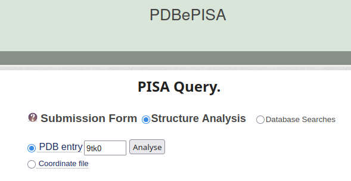{fig-align="center"}

For this to work following XML files should be saved - screenshots are provided as a guidance.

\(1\) At the interfaces panel select an interface of interest, e.g. H-A, L-A, ...

\(2\) Click on Details of that interface

\(3\) Click on XML of interfacing residues

\(4\) Save XML file

———————————————————————————————————————————

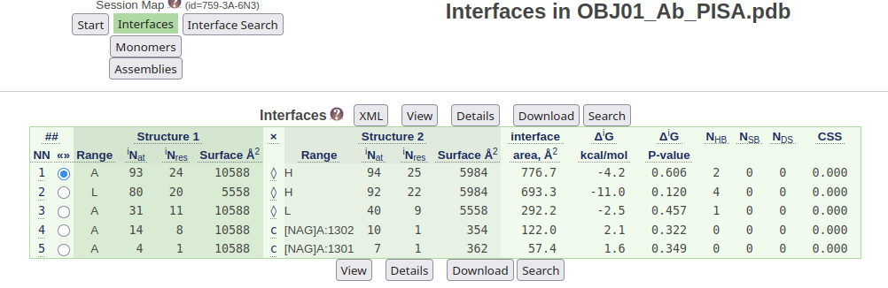{fig-align="center"}

———————————————————————————————————————————

in this case select the Details of both chains H:A and L:A, one after another.

———————————————————————————————————————————

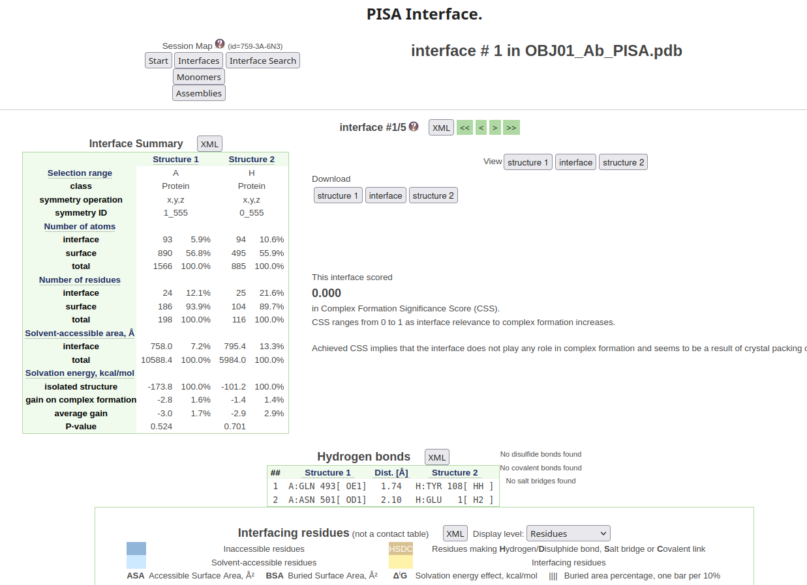

———————————————————————————————————————————

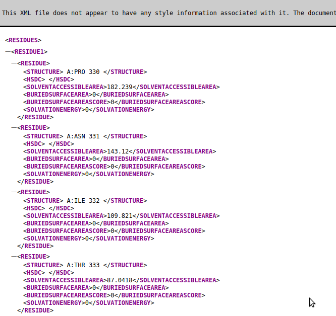

Select the XML of the interfacing residues and save this XML as `OBJ01_A_H.xml` and `OBJ01_A_L.xml` in the `data_pisa` folder.

This should be done for all relevant interfaces, in this case for chains `A/H` and `A/L`.

```{r }
pisa_xml_xtract_f <- function(df, children1, children2, children3){
  if (children3 == "NONE"){
  df_out <- df %>% xml_find_all(., children1) %>% xml_find_all(., children2) %>% xml_text(., trim = TRUE) %>% as_tibble(.)
  }
  else {
  df_out <- df %>% xml_find_all(., children1) %>% xml_find_all(., children2) %>% xml_find_all(., children3) %>% xml_text(., trim = TRUE) %>% as_tibble(.)  
  }
  return(df_out)
}


pisa_xml_tribble <- tribble(~heading, ~children1, ~children2, ~children3,
                            "HYDROGENBONDS", list("STRUCTURE"), list("STRUCTURE1", "DISTANCE", "STRUCTURE2"), list("NONE"), 
                            "RESIDUES", list("RESIDUE1", "RESIDUE2"), list("RESIDUE"), list("STRUCTURE", "BURIEDSURFACEAREA"),
                            "RESIDUES", list("RESIDUE1", "RESIDUE2"), list("RESIDUE"), list("SOLVENTACCESSIBLEAREA"),
                            "SALTBRIDGES", list("STRUCTURE"), list("STRUCTURE1", "DISTANCE", "STRUCTURE2"), list("NONE")
                            )

pisa_xml_tribble <- pisa_xml_tribble %>% unnest(., children1) %>% unchop(., children1) %>% unnest(., children2) %>% unchop(., children2) %>% unnest(., children3) %>% unchop(., children3)


#sorting data according to PIC-type

pisa_filelist = list.files(path = "./data_pisa", pattern = "*", recursive = TRUE, include.dirs = TRUE, full.names = TRUE)
pisa_filelist.tib <- as_tibble(pisa_filelist) %>% mutate(data = purrr::map(value,~read_xml(.))) %>% dplyr::mutate(., pisatype = "interface") %>% dplyr::mutate(., heading = case_when(pisatype == "hbonds" ~ "HYDROGENBONDS", pisatype == "interface" ~ "RESIDUES", pisatype == "sbridge" ~ "SALTBRIDGES", TRUE ~ "NONE")) %>% left_join(., pisa_xml_tribble) %>% dplyr::mutate(., xml_xtract = purrr::pmap(list(data, children1, children2, children3), pisa_xml_xtract_f))

# Table below contains the details from PISA that were only described in the text 

pisa_filelist_long <- pisa_filelist.tib %>% separate(., value, c("dot", "folder", "filename"), sep = "/") %>% dplyr::select(., !c("dot", "folder")) %>% separate(., filename, c("obj", "pair", "rm"), sep = "_") %>% dplyr::select(., !c("rm")) %>% dplyr::select(., obj, pair, pisatype, heading, children1, children2, children3, xml_xtract) %>% group_by(., obj, pair, pisatype, heading, children1) %>% nest() %>% dplyr::mutate(., data_wide = purrr::map(data, ~pivot_wider(., names_from = c(children2, children3), values_from = xml_xtract, names_sep = "_"))) %>% dplyr::mutate(., data_wide_unnested = purrr::map(data_wide, ~unchop(., cols = c(1:ncol(.))))) %>% dplyr::select(., -data, -data_wide) %>% dplyr::mutate(data_unnested = purrr::map(data_wide_unnested, ~unnest(.))) %>% dplyr::mutate(data_unnested = purrr::map(data_unnested, ~dplyr::select(., resid=value, bsa=value1, asa=value2))) %>% dplyr::select(., -data_wide_unnested) %>% unnest(., data_unnested) %>% separate(., resid, into = c("chain", "resid"), sep = ":") %>% dplyr::mutate(., resno = str_extract(resid,"[:digit:]{1,3}"), resaa = str_extract(resid,"[:alpha:]{1,3}")) %>% dplyr::mutate(., bsa = as.numeric(bsa), asa = as.numeric(asa), resno = as.numeric(resno)) %>% dplyr::mutate(., bsa_perc = (bsa/asa)*100) %>% dplyr::mutate(., bsa_perc = round(bsa_perc, 0)) %>% replace_na(list(bsa_perc=0)) %>% ungroup() %>% dplyr::select(., !c(heading, children1, pisatype)) %>% dplyr::select(., obj, pair, chain, resno, resaa, asa, bsa, bsa_perc) %>% group_by(., obj, pair) %>% nest(.) %>% dplyr::select(., obj, pair, pisa = data) %>% unnest(., pisa) %>% ungroup() %>% dplyr::group_by(obj, chain, resno, resaa) %>% nest() %>% dplyr::mutate(., data_sum=purrr::map(data, ~dplyr::summarize(., asa_mean=mean(asa), bsa_sum=sum(bsa), bsa_perc_sum=sum(bsa_perc)))) %>% unnest(., data_sum) %>% dplyr::mutate(., cmd = paste("/", chain, "/", resno, "/", sep="")) 

pisa_filelist_long_pymol <- pisa_filelist_long %>% left_join(., arpeggio_selections_join) %>% dplyr::filter(., bsa_sum > 0)
```

#### To show the PISA interface table

```{r PISAtable, output=TRUE}
pisa_filelist_long.tab <- pisa_filelist_long_pymol %>% dplyr::select(., !c("data"))

datatable(pisa_filelist_long.tab, filter = 'top') 
datatable(pisa_filelist_long.tab, filter = 'top') %>% saveWidget(., file = "table_pisa.html", selfcontained = TRUE)
```

#### To create the PISA visualization script for PyMol.

Outputs script to use in PyMOL.

```{r}
if (!dir.exists("./pyscripts")) {
  dir.create("./pyscripts")
}


pisa_filelist_long_sel.pymol <- pisa_filelist_long_pymol %>% dplyr::select(., !c("data")) %>% dplyr::mutate(., obj_pisa = paste(obj, "_PISA_", arpeggio, sep="") ) %>% group_by(., obj, arpeggio) %>% nest() %>% dplyr::mutate(., pymol_cmd = purrr::map(data, ~dplyr::mutate(., cmd = paste("alter ", obj_pisa, " and chain ", chain ," and resi ",resno, ", b=", bsa_perc_sum, ";", sep = "")))) %>% dplyr::mutate(., pymol_cmd = purrr::map(pymol_cmd, ~dplyr::ungroup(.))) %>% dplyr::mutate(., pymol_cmd = purrr::map(pymol_cmd, ~dplyr::select(., cmd))) %>% dplyr::mutate(., pathname = paste("./pyscripts/", "pisa_bsa_", obj,"_", arpeggio, ".pml", sep = ""))

pwalk(list(pisa_filelist_long_sel.pymol$pymol_cmd, pisa_filelist_long_sel.pymol$pathname), write_csv_pymol_f)
```

With these PISA visualization scripts exported to `pyscripts`the analysis continues in PyMol, starting with `scene_005.`

The main purpose of this PISA analysis is to visualize the buried surface areas.

———————————————————————————————————————————

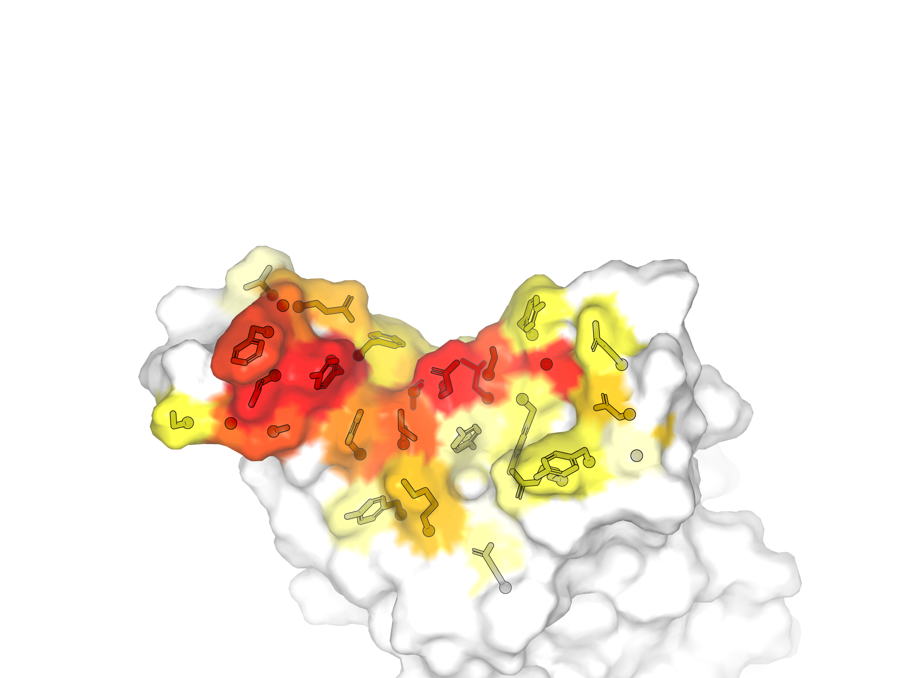

———————————————————————————————————————————

The PyMol session is continued until `scene_010.`

———————————————————————————————————————————

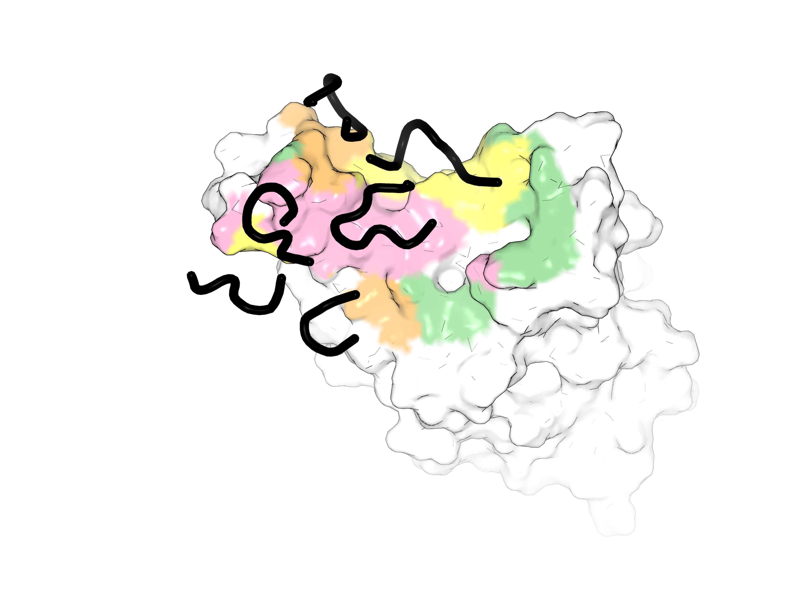

———————————————————————————————————————————

Now we have defined the CDR regions of the antibodies, or other focus groups to generate custom bsa boxplots.

#### PISA focusgroups

To get the PISA-focus groups, CDR and framework regions were defined using IMGT. This can only be run after the PISA analysis and visualization in PyMol where the `listselection` script is used to define focus regions. The txt files comprising the focus regions are copied to the newly created `pisarp_focus` folder.

Furthermore, the `listselection_OBJ00_AGN-ACEb.txt` file has been created previously for another project and was just copied herein.

```{r}
if (!dir.exists("./pisarp_focus")) {
  dir.create("./pisarp_focus")
}

```

```{r ImportPISAfocus, echo=FALSE}
pisafocus_filelist = list.files(path = "./pisarp_focus/", pattern = "*.txt")
pisafocus_filelist.dat <- data.frame(folder = c(rep("./pisarp_focus/", length(pisafocus_filelist))), files = pisafocus_filelist)
pisafocus_filelist.dat$read <- paste(pisafocus_filelist.dat$folder, pisafocus_filelist.dat$files, sep = "")
pisafocus_filelist.tib <- as_tibble(pisafocus_filelist.dat)

pisafocus_filelist.tib <- pisafocus_filelist.tib %>% dplyr::select(files,read) %>% separate(files, into = c("listselection","obj","pisafocustxt"), sep="_") %>% separate(pisafocustxt, into = c("arpisa_focus", "txt"), sep="\\.") %>% dplyr::select(., !c("listselection", "txt")) %>% mutate(data = purrr::map(read,~read_delim(.,skip=1, delim = " ", col_names = c("selection")))) %>% dplyr::mutate(data = purrr::map(data,~separate(., selection,into = c("pysel", "chain", "resaa", "resid"), sep = "\\\\"))) %>% dplyr::mutate(data = purrr::map(data,~dplyr::mutate(., resid = as.numeric(resid)))) 

pisafocus_selections.tib <- pisafocus_filelist.tib %>% dplyr::mutate(., cmd = purrr::map(data, ~unite(., cmd, c("chain", "resid"), sep="/"))) %>% dplyr::mutate(., cmd = purrr::map(cmd, ~dplyr::mutate(., before = "/", after = "/"))) %>% dplyr::mutate(., cmd = purrr::map(cmd, ~unite(., cmd, c("before", "cmd", "after"), sep=""))) %>% dplyr::mutate(., cmd = purrr::map(cmd, ~dplyr::select(., cmd))) %>% dplyr::mutate(., filename = paste("./arpisa_focus/", obj, "_", arpisa_focus, ".txt", sep = ""))

pisafocus_selections.sel <- pisafocus_selections.tib %>% dplyr::select(., obj, pisafocus = arpisa_focus, cmd)

pisafocus_selections_join <- pisafocus_selections.sel %>% unnest(., cmd) %>% separate(., pisafocus, into = c("domain", "region"))

```

#### To summarizie PISA in boxplots

The buried surface areas are then visualized taking into account the selections and focus groups, using colors matching those used in PyMol. The plot `ggplot_pisa_bsa_1.jpeg` also shows the contribution of ACE2 epitope residues to the binding interface if the corresponding PISA data are provided.   

Optional: Import reference bsa values from ACE2 analysis.

```{r}
ref_pisafocus_list = list.files(path = "../", pattern = "ref_pisafocus_selections_join.rds", recursive = TRUE, include.dirs = TRUE, full.names = TRUE) 

ref_pisafocus_list.tib <- as_tibble(ref_pisafocus_list) %>% separate(., value, into = c("dot", "empty", "foldername", "plotname"), sep = "\\/", remove = FALSE) %>% dplyr::select(., !c("dot", "empty")) %>% separate(., foldername, into = c("NBIS", "pre", "Name", "Date", "sample"), sep = "_") %>% dplyr::select(., c("value", "sample", "plotname")) %>% dplyr::mutate(., plottype = str_remove(plotname, "\\.rds")) %>% dplyr::select(., !c("plotname")) %>% dplyr::mutate(., data = purrr::map(value, ~readRDS(.))) %>% dplyr::select(., !c("value")) 

ref_pisafocus_selections_join <- ref_pisafocus_list.tib %>% unnest(., data) %>% dplyr::select(., !c("sample", "plottype"))

```

```{r}
# Function to split a value into smaller units
split_value_f <- function(value, unit) {
  if (value == 0) {
    return(tibble(unit_value = 0, part = 1))
  } else if (value < unit) {
    return(tibble(unit_value = value, part = 1))
  } else {
    full_units <- value %/% unit  # Number of full units
    remainder <- value %% unit  # Remaining value after full units
    
    # Create a data frame with full units
    units_df <- tibble(
      unit_value = rep(unit, full_units),
      part = 1:full_units
    )
    
    # Add the remainder if it's greater than 0
    if (remainder > 0) {
      units_df <- units_df %>%
        add_row(unit_value = remainder, part = full_units + 1)
    }
    
    return(units_df)
  }
}

chain_adjustements <- tribble(~obj, ~arpeggio, ~chain, ~chain_adj,
                              "OBJ00", "AB1", "D", "H",
                              "OBJ01", "AB1", "L", "L",
                              "OBJ01", "AB1", "H", "H")

# if evaluated as OBJ00 in the same scripts as OBJ01 
#ref_pisafocus_selections_join <- pisafocus_selections_join %>% dplyr::filter(., obj == "OBJ00") %>% dplyr::select(., !c("obj"))

noref_pisafocus_selections_join <- pisafocus_selections_join %>% dplyr::filter(., obj != "OBJ00")

pisa_filelist_long_sel <- pisa_filelist_long_pymol %>% left_join(., ref_pisafocus_selections_join) %>% left_join(., noref_pisafocus_selections_join, by = c("obj", "cmd")) %>% dplyr::mutate(., domain = coalesce(domain.x, domain.y), region = coalesce(region.x, region.y)) %>% dplyr::select(., !c("domain.x", "domain.y","region.x", "region.y")) %>% dplyr::mutate(., domain_mod = coalesce(domain, arpeggio)) %>% dplyr::mutate(., region_col = coalesce(region, domain_mod)) %>% dplyr::select(., !c("domain", "domain_mod"))

pisa_filelist_long_sel_regionsum <- pisa_filelist_long_sel %>% dplyr::group_by(obj, arpeggio, chain, region_col) %>% dplyr::summarize(., bsa_sum = sum(bsa_sum)) %>% left_join(., chain_adjustements) %>% dplyr::mutate(chain_adj = coalesce(chain_adj, chain)) %>% ungroup() %>% dplyr::select(., obj, arpeggio, chain=chain_adj, region_col, bsa_sum)

# To plot Rec
pisa_ligand_plot_1_pre.tib <- pisa_filelist_long_sel_regionsum %>% dplyr::filter(., arpeggio == "SPIKE") 

pisa_ligand_plot_1.tib <- pisa_ligand_plot_1_pre.tib %>% ggplot(data=.) + geom_col(aes(x=chain, y = bsa_sum, fill = region_col), colour="black", size=0.5, position = position_stack(reverse = TRUE)) +
#scale_fill_gradient2("bsa: Å", midpoint = 80, low="lightblue", mid="blue", high="red", space ="Lab") +
  scale_fill_manual(values = region_colors, drop=FALSE) +
  theme_minimal() +
  theme(panel.grid.major.x = element_blank()) +
  #  scale_x_discrete() +
  #theme(legend.position = "none") +
  scale_y_continuous(minor_breaks = NULL) +
  #scale_x_continuous("bsa: Å", breaks = c(0,250, 500)) +
  coord_cartesian(ylim = c(0,1200)) +
  #geom_text( aes(label = res1AA, y = -5), position = position_dodge(0.9), vjust = 0) +
  facet_grid(obj ~ .)
  #print(molprob_filelistdata_int_sum_ligres_area_sum_plot.tib)
  ggsave(file="ggplot_pisa_bsa_1.jpeg", plot=pisa_ligand_plot_1.tib,device="jpeg", width = 55, height = 90, units = c("mm"))
  ggsave(file="ggplot_pisa_bsa_1.ps", plot=pisa_ligand_plot_1.tib,device="ps", width = 55, height = 90, units = c("mm"))

  # To plot Ab1
  pisa_ligand_plot_2_pre.tib <- pisa_filelist_long_sel_regionsum %>% dplyr::filter(., arpeggio == "AB1") 
  pisa_ligand_plot_2.tib <- pisa_ligand_plot_2_pre.tib %>% ggplot(data=.) + geom_col(aes(x=chain, y = bsa_sum, fill = region_col), colour="black", size=0.5) +
#scale_fill_gradient2("bsa: Å", midpoint = 80, low="lightblue", mid="blue", high="red", space ="Lab") +
  scale_fill_manual(values = region_colors, drop=FALSE) +
  theme_minimal() +
      theme(panel.grid.major.x = element_blank()) +

  #scale_x_discrete(breaks=NULL) +
  #theme(legend.position = "none") +
  scale_y_continuous(minor_breaks = NULL) +
  #scale_x_continuous("bsa: Å", breaks = c(0,250, 500)) +
  coord_cartesian(ylim = c(0,1200)) +
  #geom_text( aes(label = res1AA, y = -5), position = position_dodge(0.9), vjust = 0) +
  facet_grid(obj ~ .)
  #print(molprob_filelistdata_int_sum_ligres_area_sum_plot.tib)
  ggsave(file="ggplot_pisa_bsa_2.jpeg", plot=pisa_ligand_plot_2.tib,device="jpeg", width = 65, height = 90, units = c("mm"))
  ggsave(file="ggplot_pisa_bsa_2.ps", plot=pisa_ligand_plot_2.tib,device="ps", width = 65, height = 90, units = c("mm"))
  
# To plot bricks of Ab regions
  
  pisa_ligand_plot_3.tib <- pisa_filelist_long_sel_regionsum %>% dplyr::filter(., arpeggio == "AB1") %>% group_by(obj, arpeggio, chain, region_col) %>% mutate(., bsa_split = list(split_value_f(bsa_sum, 50))) %>% unnest(bsa_split) %>% ggplot(data=.) + geom_col(aes(x=region_col, y = unit_value), fill="grey", colour="black", size=0.5) +
#scale_fill_gradient2("bsa: Å", midpoint = 80, low="lightblue", mid="blue", high="red", space ="Lab") +
  scale_fill_manual(values = region_colors, drop=FALSE) +
  theme_minimal() +
      theme(panel.grid.major.x = element_blank()) +

  #scale_x_discrete(breaks=NULL) +
  #theme(legend.position = "none") +
  #scale_y_continuous(minor_breaks = NULL) +
  #scale_x_continuous("bsa: Å", breaks = c(0,250, 500)) +
  coord_cartesian(ylim = c(350,0)) +
  scale_y_reverse(minor_breaks = NULL) +
  #geom_text( aes(label = res1AA, y = -5), position = position_dodge(0.9), vjust = 0) +
  facet_grid(obj ~ chain)
  #print(molprob_filelistdata_int_sum_ligres_area_sum_plot.tib)
  ggsave(file="ggplot_pisa_bsa_3.jpeg", plot=pisa_ligand_plot_3.tib,device="jpeg", width = 90, height = 180, units = c("mm"))
  ggsave(file="ggplot_pisa_bsa_3.ps", plot=pisa_ligand_plot_3.tib,device="ps", width = 90, height = 180, units = c("mm"))
```

```{r PisaStats}
#pisa_filelist_long_sel_resP
pisa_filelist_long_sel_resP_chain.stats <- pisa_filelist_long_sel_regionsum %>% ungroup() %>% dplyr::group_by(., obj, arpeggio, chain, region_col) %>% dplyr::summarize(., bsa_region_chain=sum(bsa_sum)) %>% dplyr::mutate(., bsa_arpeggio=sum(bsa_region_chain)) %>% dplyr::mutate(., bsa_perc_chain=(round((bsa_region_chain/bsa_arpeggio)*100, 1) )) 

pisa_filelist_long_sel_resP.stats <- pisa_filelist_long_sel_resP_chain.stats %>% ungroup() %>% dplyr::group_by(., obj, arpeggio, region_col) %>% dplyr::summarize(., bsa_arp_chain = sum(bsa_arpeggio)) %>% ungroup %>% dplyr::group_by(., obj, arpeggio, region_col) %>% dplyr::group_by(., obj, arpeggio, region_col) %>% right_join(., pisa_filelist_long_sel_resP_chain.stats) %>% dplyr::mutate(., bsa_perc_region= (round((bsa_region_chain/bsa_arp_chain)*100, 1))) %>% dplyr::arrange(., obj, arpeggio, chain, region_col)

#pisa_filelist_long_sel_resP_50.stats <- pisa_filelist_long_sel_resP.stats %>% ungroup() %>% dplyr::filter(., bsa_perc_sum > 49.99) %>% dplyr::group_by(., obj, arpeggio, region_col) %>% dplyr::summarize(., bsa_region=sum(bsa_sum)) %>% dplyr::mutate(., bsa_arpeggio=sum(bsa_region)) %>% dplyr::mutate(., bsa_perc=(bsa_region/bsa_arpeggio)*100)

datatable(pisa_filelist_long_sel_resP.stats, filter = 'top') 
datatable(pisa_filelist_long_sel_resP.stats, filter = 'top') %>% saveWidget(., file = "table_pisastats.html", selfcontained = TRUE)

```

##### ———————————————————————————————————————————

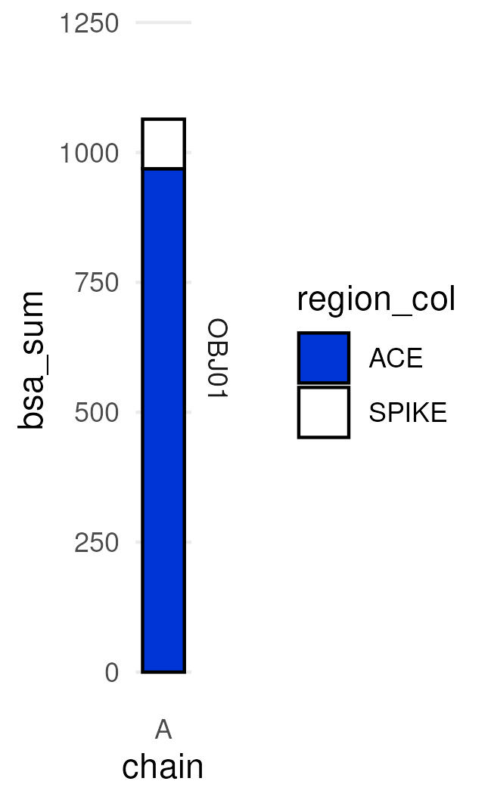{width="180"}

———————————————————————————————————————————

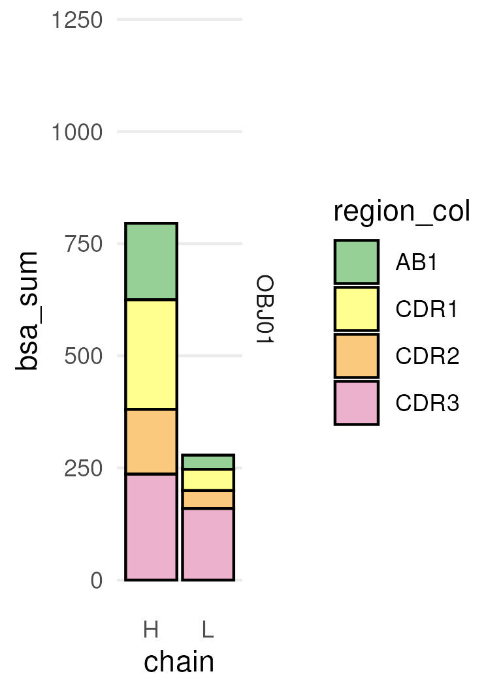{width="163"}

———————————————————————————————————————————

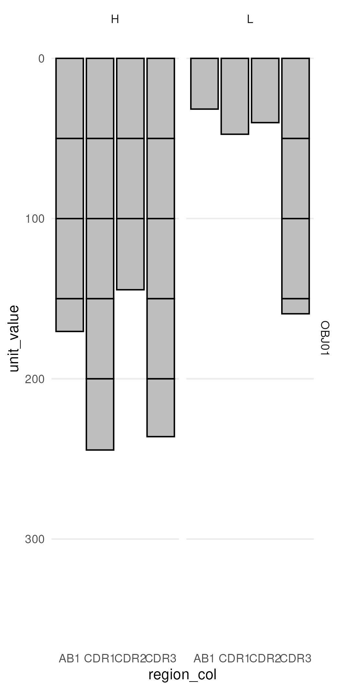{width="201"}

———————————————————————————————————————————

## Arpeggio analysis/visualization

### Arpeggio analysis

You can upload the PDB to the server or just , the contents of the respective files in the folder `arp_selections` are uploaded into the respective selection field of the arpeggio server. This is to specify which interactions we are interested in. To analyse the molecular interactions the PDB file is uploaded to [Arpeggio](#0), and all results are downloaded.

Select to analyze the contacts between chains H&L against everything else.

———————————————————————————————————————————

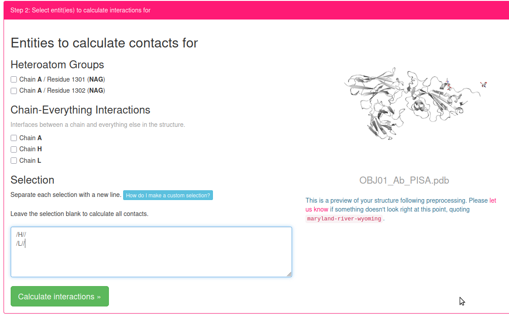

———————————————————————————————————————————

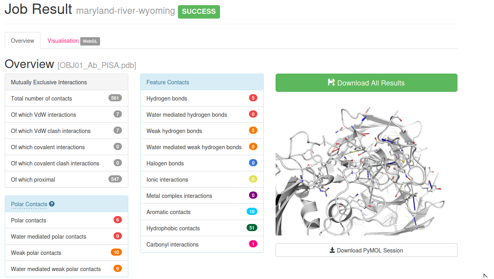

———————————————————————————————————————————

Compare the listed contacts with the final plots. For visualization purposes and simplification, only strong H bonds and hydrophobic contacts are selected for visualization in PyMol and the boxplots.

———————————————————————————————————————————

Download All results, and copy the `contacts` file into the `data_arpeggio` folder and rename the file to `OBJ01_AB1.contacts`.

The Zipped folder also contains a PyMol session file where all interactions are already visualized.

However, I wanted to integrate the interactions within my own PyMol sessions and to visualize key interactions with my own style. Furthermore, the R analysis script creates additional plots that may or may not be useful.


### Tidying Arpeggio interaction fingerprints for custom PyMol visualization and additional plots.

#### To process the Arpeggio output

```{r}
if (!dir.exists("./data_arpeggio")) {
  dir.create("./data_arpeggio")
}

```

*This needs to be checked. Define the chain(s) of the Ab*

```{r}
arpeggio_chain_filter <- tribble(~obj, ~chain1, ~keep,
                                 "OBJ01", "H", "Y",
                                 "OBJ01", "L", "Y")
```

```{r}
read_tsv_pdbsum_f <- function(file, col_names){
  col_names_vec <- col_names %>% dplyr::select(., PDBres) %>% pull() 
  pdbsum_data <- vroom(file = file, col_names = col_names_vec)
  return(pdbsum_data)
}

PDBsum_sort_tribble <- tribble(~no_col, ~named_col, ~filetype,
                        17, enframe( c("id1", "id2","Clash", "Covalent", "vdW_Clash", "VdW", "Proximal", "HydrogenBond","weakHydrogenBond", "HalogenBond", "Ionic", "MetalComplex", "Aromatic", "Hydrophobic", "Carbonyl", "Polar", "WeakPolar", "ENTITIES"), value = "PDBres"), "contacts"
                        )

PDBsum_rank_tribble <- PDBsum_sort_tribble %>% dplyr::select(., named_col) %>% unnest(., named_col) %>% dplyr::slice(., 3:17) %>% dplyr::select(., PDBres) %>% add_column(., rank = c(1, 2, 1, 1, 1, 3, 1, 3, 4, 3, 3, 2, 1, 2, 1)) %>% add_column(., ranktype = c("distance", "distance", "distance", "distance", "distance", "polar", "distance", "polar", "polar", "polar", "nonpolar", "nonpolar", "polar", "polar", "distance")) %>% dplyr::select(., name = PDBres, rank, ranktype)


#reshaping the data using tidyverse
#PDBsum_sort_tribble <- PDBsum_sort_tribble %>% left_join(., PDBsum_pdbs_tribble)

test_ligchain_f <- function(chain1, lig_chain){
  case_when()
}

#check bbsc
analyze_arpeggio_f <- function(data){
  data_out <- data %>% left_join(., PDBsum_rank_tribble) %>% group_by(., id1, atom1, id2, atom2) %>% nest() %>% dplyr::mutate(., data_ranked = purrr::map(data, ~dplyr::filter(., rank == max(rank)))) %>% dplyr::mutate(., ncolumn = purrr::map(data, ~nrow(.))) %>% unchop(., ncolumn) #%>% dplyr::mutate(., bbsc1 = case_when(atom1 == "O" ~ "bb", atom1 == "N" ~ "bb", atom1 == "C" ~ "bb", atom1 == "CA" ~ "bb", TRUE ~ "sc"), bbsc2 = case_when(atom2 == "O" ~ "bb", atom2 == "N" ~ "bb", atom2 == "C" ~ "bb", atom2 == "CA" ~ "bb", TRUE ~ "sc")) %>% unite(., "bbsc", c("bbsc1", "bbsc2"), sep = "_", remove=FALSE)
  return(data_out) 
}

arpeggio_chainsort_f <- function(data, sel_chain){
  sel_chain_letter <- sel_chain[[1]]
  data_out <-  data %>% separate(., id1, c("chain1", "number1", "atom1"), sep = "\\/", remove = FALSE) %>% separate(., id2, c("chain2", "number2", "atom2"), sep = "\\/", remove = FALSE) %>% dplyr::mutate(., id1_corr = case_when(chain1 == sel_chain_letter ~ id1, TRUE ~ id2), id2_corr = case_when(chain2 == sel_chain_letter ~ id1, TRUE ~ id2)) %>% dplyr::select(., -id1, -chain1, -number1, -atom1, -id2, -chain2, -number2, -atom2) %>% separate(., id1_corr, c("chain1", "number1", "atom1"), sep = "\\/", remove = FALSE) %>% separate(., id2_corr, c("chain2", "number2", "atom2"), sep = "\\/", remove = FALSE) 
  return(data_out)
}

# to replace arpeggio_rec_lig_f
arpeggio_id_f <- function(data){
  data1 <- data
  data2 <- data %>% dplyr::select(., id1=id2, id2=id1, ENTITIES, name, value) 
  data_out <- full_join(data1, data2) %>% separate(., id1, c("chain1", "number1", "atom1"), sep = "\\/", remove=FALSE) %>% separate(., id2, c("chain2", "number2", "atom2"), sep = "\\/", remove=FALSE) %>% dplyr::mutate(., cmd = paste("/",chain1, "/", number1, "/", sep=""))
  return(data_out)
}

# this takes only the data_ranked from data_long2!, thus essentially polar contacts replace proximal.
arpeggio_sort_f <- function(data){
data_out <-  data %>% dplyr::mutate(., nrows = purrr::map(data_ranked, ~nrow(.))) %>% unnest(nrows) %>% ungroup() %>% dplyr::select(., -data) %>% unnest(data_ranked) %>% group_by(id1, id2) %>% nest()
return(data_out)
}

#check bbsc
arpeggio_sum_f <- function(data){ #data %>% dplyr::mutate(., data_filtered = purrr::map(data, ~group_by(., bbsc)))
  data_out <- data %>% dplyr::mutate(., data_filtered = purrr::map(data, ~dplyr::filter(., rank == max(rank), ranktype != "distance"))) %>% dplyr::mutate(., data_sum = purrr::map(data_filtered, ~dplyr::summarize(., interaction_type = unique(name))))
  return(data_out)
}

arpeggion_rescount_f <- function(data){
  data_out <- data %>% dplyr::select(., number1, number2, data) %>% unnest(., cols = c("data")) %>% dplyr::group_by(., lig_chain, number1, rec_chain, number2, ranktype, name) %>% dplyr::summarize(., count = n())
  return(data_out)
}

arpeggio_atomlevel_f <- function(data){
  data_out <- data %>% dplyr::select(., !c("data_filtered", "data_sum")) %>% unnest(., c("data")) %>% dplyr::mutate(., name_cor = case_when(name == "VdW" ~ "Proximal", name == "vdW_Clash" ~ "Proximal", TRUE ~ name)) %>% dplyr::select(., !c("name")) %>% dplyr::mutate(., name = name_cor)
  return(data_out)
}

arpeggio_reslevel_f <- function(data){
  data_out <- data %>% dplyr::group_by(., chain1, number1, ranktype, name) %>% dplyr::summarize(., count = n())
  return(data_out)
}


arpeggio_liglevel_f <- function(data){
  data_out <- data %>% ungroup() %>% dplyr::group_by(., chain1, number1, name) %>% dplyr::summarize(sumcount = sum(count))
  return(data_out)
}

# PISA/Arpeggio selection import
#pisa_pdb_tribble <- tribble(~binder, ~PDB, ~sel_chain, 
#                            "cat", "XXX", "A")
                            #"fab", "3GJF", "A", "C", "H", "L",
                            #"dar", "4A8", "A", "C", "D", "D")

#PDB_assignment <- tribble(~binder, ~chain2, ~complex,
#                          "cat", c("B", "C", "D", "E"), "intra",
#                          "cat", c("F", "G", "H", "I", "J"), "inter")

#PDB_assignment <- PDB_assignment %>% unnest(., chain2)

pdbsum_filelist = list.files(path = "./data_arpeggio", pattern = "*", recursive = TRUE, include.dirs = TRUE, full.names = TRUE)

pdbsum_filelist.tib <- as_tibble(pdbsum_filelist) %>% separate(., value, into = c("folder", "subfolder", "filename"), sep = "\\/", remove = FALSE) %>% separate(., filename, into = c("obj", "filetype"), sep = "_") %>% separate(., filetype, into = c("arpeggio", "filetype")) %>% left_join(., PDBsum_sort_tribble)  %>% mutate(data = purrr::pmap(list(value, named_col), read_tsv_pdbsum_f)) %>% dplyr::mutate(., data_mod = purrr::map(data, ~dplyr::mutate(., across(.cols = !c("id1", "id2", "ENTITIES"), .fns = ~case_when(. >  0 ~ "interaction"))))) %>% dplyr::mutate(., data_long = purrr::map(data_mod, ~pivot_longer(., cols = !c("id1", "id2", "ENTITIES"), values_drop_na = TRUE))) %>% dplyr::mutate(., data_long_id = purrr::map(data_long, ~arpeggio_id_f(.))) %>% dplyr::mutate(., data_long2 = purrr::map(data_long_id, ~analyze_arpeggio_f(.)))  %>% dplyr::mutate(., data_long3 = purrr::map(data_long2, ~arpeggio_sort_f(.))) %>% dplyr::mutate(., data_boxplot = purrr::map(data_long3, ~arpeggio_sum_f(.))) 

# data_long2 is same as shown on arpeggio webserver
# data_long3 is after ranking of the interactions 
# pdbsum_filelist.tib$data should be the same as from web-server

# pdbsum_filelist.tib$data_long2[[1]] %>% unnest(data) %>% dplyr::group_by(., chain1, name) %>% tally()

#pdbsum_filelist_atomlevel.old <- pdbsum_filelist_atomlevel.tib

pdbsum_filelist_levels.tib <- pdbsum_filelist.tib %>% dplyr::select(., obj, arpeggio, data_boxplot) %>% unite(., obj_arpeggio, c("obj", "arpeggio")) %>% dplyr::mutate(., data_atomlevel = purrr::map(data_boxplot, ~arpeggio_atomlevel_f(.))) %>% dplyr::mutate(., data_reslevel = purrr::map(data_atomlevel, ~arpeggio_reslevel_f(.))) %>% dplyr::mutate(., data_liglevel = purrr::map(data_reslevel, ~arpeggio_liglevel_f(.)))

pdbsum_filelist_atomlevel.tib <- pdbsum_filelist_levels.tib %>% dplyr::select(., obj_arpeggio, data_atomlevel) %>% unnest(., c("data_atomlevel"))

#pdbsum_filelist_reslevel.old <- pdbsum_filelist_reslevel.tib

pdbsum_filelist_reslevel.tib <- pdbsum_filelist_levels.tib %>% dplyr::select(., obj_arpeggio, data_reslevel) %>% unnest(., c("data_reslevel"))

pdbsum_filelist_liglevel.tib <- pdbsum_filelist_levels.tib %>% dplyr::select(., obj_arpeggio, data_liglevel) %>% unnest(., c("data_liglevel"))

get_column_value <- function(df, filterme){
  out <- df %>% dplyr::filter(., binder == filterme) %>% pull(sumbinder)
  return(out)
}

arpfeature_tib <- tribble(~ranktype, ~name, ~arpclass,
                       "distance", "WeakPolar", "weak",
                       "distance", "weakHydrogenBond", "weak")

feature_contacts.tib <- pdbsum_filelist.tib %>% dplyr::select(., obj, arpeggio, filetype, data_long2) %>% unnest(., data_long2) %>% dplyr::select(., !data_ranked) %>% unnest(., data) %>% dplyr::group_by(., obj, arpeggio, chain1, ranktype, name) %>% tally(., name = "sumcount") %>% left_join(., arpfeature_tib) %>% replace_na(., list(arpclass = "strong"))

feature_contacts_residue.tib <- pdbsum_filelist.tib %>% dplyr::select(., obj, arpeggio, filetype, data_long2) %>% unnest(., data_long2) %>% dplyr::select(., !data_ranked) %>% unnest(., data) %>% dplyr::group_by(., obj, arpeggio, chain1, number1, ranktype, name) %>% tally(., name = "sumcount") %>% left_join(., arpfeature_tib) %>% replace_na(., list(arpclass = "strong"))

feature_contacts_contact.map <- pdbsum_filelist.tib %>% dplyr::select(., obj, arpeggio, filetype, data_long2) %>% unnest(., data_long2) %>% dplyr::select(., !data_ranked) %>% unnest(., data) %>% left_join(., arpeggio_chain_filter) %>% drop_na(., keep) %>% dplyr::select(., !c("keep")) %>% dplyr::group_by(., obj, arpeggio, chain1, number1, chain2, number2, ranktype, name) %>% tally(., name = "sumcount") %>% left_join(., arpfeature_tib) %>% replace_na(., list(arpclass = "strong"))

#pdbsum_filelist_bbsclevel_bbsconly_perc <- pdbsum_filelist_bbsclevel_bbsconly.tib %>% dplyr::summarize(., sumbinder = sum(sumcount)) %>% ungroup() %>% dplyr::select(., binder, sumbinder) %>% pivot_wider(., names_from =c("binder"), values_from = c("sumbinder")) %>% dplyr::mutate(., dar_tcr = dar/tcr, dar_fab = dar/fab)
```

#### To summarize the Arpeggio interactions

```{r}
yrb_yellow <- rgb(245, 163, 19, maxColorValue = 255, name = "yrb_yellow") %>% enframe() %>% pull(value)
yrb_lyellow <- rgb(245, 201, 19, maxColorValue = 255, name = "yrb_lyellow") %>% enframe() %>% pull(value)
yrb_l2yellow <- rgb(245, 239, 19, maxColorValue = 255, name = "yrb_l2yellow") %>% enframe() %>% pull(value)
yrb_red <- rgb(241, 98, 99, maxColorValue = 255, name = "yrb_red") %>% enframe() %>% pull(value)
yrb_lred <- rgb(247, 168, 169,maxColorValue = 255, name = "yrb_lred") %>% enframe() %>% pull(value)
yrb_blue <- rgb(61, 130, 196, maxColorValue = 255, name = "yrb_blue") %>% enframe() %>% pull(value)
yrb_lblue <- rgb(120, 168, 214, maxColorValue = 255, name = "yrb_lblue") %>% enframe() %>% pull(value)
yrb_neutral <- rgb(216, 191, 216, maxColorValue = 255, name = "yrb_tan") %>% enframe() %>% pull(value) #col2rgb("tan")
yrb_pisa <- rgb(202, 125, 204, maxColorValue = 255, name = "yrb_pisa") %>% enframe() %>% pull(value) #col2rgb("tan")

#sorting data according to PIC-type
arpeggio_sort_tribble <- tribble(~PIC_type, ~PIC_gencolor, ~PIC_typecolor, 
                        "Hydrophobic", yrb_yellow, yrb_yellow,
                        "Hydrogen", yrb_blue, yrb_blue,
                        "Ionic", yrb_blue, yrb_lblue,
                        "Aromatic", yrb_yellow, yrb_lyellow,
                        "Cation-Pi", yrb_yellow, yrb_l2yellow,
                        "Other", yrb_neutral, yrb_neutral)


arpeggio_coltribble <- arpeggio_sort_tribble


arpeggio_AA_tribble <- arpeggio_coltribble %>% right_join(., AA_tribble) %>% dplyr::mutate(AA_typecolor = case_when(AAcolor == "NEG" ~ yrb_red, TRUE ~ PIC_typecolor))

arpeggio_coltribble_col <- arpeggio_coltribble %>% dplyr::select(PIC_type, PIC_typecolor) %>% deframe(.)
arpeggio_coltribble_col_all <- arpeggio_coltribble %>% dplyr::select(PIC_type, PIC_gencolor) %>% deframe(.)

arpeggio_AA_tribble_col <- arpeggio_AA_tribble %>% dplyr::select(resaa, AA_typecolor) %>% deframe(.)

pdbsum_filelist_preboxplot.tib <- pdbsum_filelist_liglevel.tib #%>% left_join(., arpeggio_sel_filelist.tib) %>% dplyr::mutate(., IMGT = str_extract(pyname, "MHCh1|MHCh2|PEP"))

#sel_binder_chains_filter.tib <- sel_binder_chains.tib %>% dplyr::select(., binder, rec_chain = chain, number2 = resid, resaa)

#pdbsum_filelist_resplot.tib <- pdbsum_filelist_reslevel.tib %>% left_join(., sel_binder_chains_filter.tib) %>% group_by(., PDB, binder, lig_chain, number1, rec_chain, resaa) %>% dplyr::summarize(., sumcount = sum(count)) 

#pdbsum_filelist_AAcount.tib <- pdbsum_filelist_resplot.tib %>% left_join(., AA_tribble) %>% ungroup() %>% group_by(PDB, binder, lig_chain, number1, PIC_type) %>% dplyr::summarize(., countAA = n()) 
```

To create res-level stats table

```{r}
#%>% dplyr::mutate(., number1 = as.numeric(number1))

pdbsum_filelist_preboxplot.stats <- pdbsum_filelist_preboxplot.tib %>% dplyr::filter(., !grepl('Proximal|weak|Weak', name))

datatable(pdbsum_filelist_preboxplot.stats, filter = 'top') 
datatable(pdbsum_filelist_preboxplot.stats, filter = 'top') %>% saveWidget(., file = "table_arp_resstats.html", selfcontained = TRUE)


```

#### To visualize the Arpeggio molecular interaction fingerprints (MIF)

##### MIF interactions ranked
**Note:** Compared to the standard Arpeggio output I have initially applied residue-level interaction ranking, according to the ranking table below. 
Thus, an ionic contact supersedes a hydrogen bond, or an aromatic supersedes hydrophobic. This resulted in a slightly cleaner PyMol Figure. Also I have focused on hydrophobic interactions and hydrogen bonds for the visualization. These interactions are typically the dominant forces governing protein-protein interactions.

```{r}
#%>% dplyr::mutate(., number1 = as.numeric(number1))

PDBsum_rank_tribble.stats <- PDBsum_rank_tribble %>% dplyr::filter(., ranktype != "distance") %>% dplyr::arrange(., ranktype, rank)

datatable(PDBsum_rank_tribble.stats, filter = 'top') 
datatable(PDBsum_rank_tribble.stats, filter = 'top') %>% saveWidget(., file = "table_arp_rank.html", selfcontained = TRUE)


```

##### Per residue MIF counting plot

```{r}
arpeggio_assign_color <- pdbsum_filelist_preboxplot.tib %>% dplyr::group_by(., name) %>% dplyr::summarize() %>% dplyr::mutate(., PIC_type = case_when(name == "Carbonyl" ~ "Other", name == "HydrogenBond" ~ "Hydrogen", name == "Polar" ~ "Hydrogen", name == "Proximal" ~ "Other", name == "VdW" ~ "Other", name == "vdW_Clash" ~ "Other", name == "weakHydrogenBond" ~ "Other", name == "WeakPolar" ~ "Other", TRUE ~ name)) %>% left_join(., arpeggio_coltribble) %>% dplyr::mutate(., priority = case_when(name == "Proximal" ~ "a", name == "Hydrophobic" ~ "b", name == "Aromatic" ~ "c", name == "HydrogenBond" ~ "d", name == "Ionic" ~ "e", name == "Polar" ~ "f", name == "weakHydrogenBond" ~ "g", name == "WeakPolar" ~ "h", name == "Carbonyl" ~ "i", name == "WeakPolar" ~ "j", TRUE ~ "k")) %>% unite(., col = "name_priority", c("priority", "name"), sep = ".", remove = FALSE) %>% dplyr::mutate(., facetPIC = case_when(name_priority == "c.Aromatic" ~ "b.Hydrophobic", name_priority == "e.Ionic" ~ "d.HydrogenBond", TRUE ~ name_priority)) %>% dplyr::mutate(., filled = case_when(PIC_type == "Aromatic" ~ "N", PIC_type == "Other" ~ "Y", PIC_type == "Ionic" & name == "Ionic" ~ "N", PIC_type == "Ionic" & name == "HydrogenBond" ~ "Y", PIC_type == "Hydrophobic" ~ "Y", PIC_type == "Hydrogen" ~ "Y"))

arpeggio_assign_color_col <- arpeggio_assign_color %>% dplyr::select(., name=PIC_type, PIC_typecolor) %>% deframe(.)
arpeggio_assign_color_col_res <- arpeggio_assign_color %>% dplyr::select(., name, PIC_typecolor) %>% deframe(.)
  
# new plot (interactions not ranked), in accordance with Arpeggio output
# priority filters out only feature contacts without weak, carbonyl or polar contacts. 
  
feature_contacts_residue_contactplot_pre.tib <- feature_contacts_contact.map %>% dplyr::filter(., arpclass == "strong")  %>% dplyr::mutate(., name_cor = case_when(name == "VdW" ~ "Proximal", name == "vdW_Clash" ~ "Proximal", TRUE ~ name)) %>% dplyr::select(., !c("name")) %>% dplyr::mutate(., name = name_cor) %>% dplyr::mutate(., number1 = as.numeric(number1), number2 = as.numeric(number2))  %>% dplyr::mutate(., scaling = case_when(name == "Proximal" ~ 0.2, name == "HydrogenBond" ~ 5, name == "Ionic" ~ 2, TRUE ~ 1)) %>% dplyr::mutate(., count_scaled = sumcount*scaling) %>% left_join(., arpeggio_assign_color) %>% dplyr::filter(., priority < "f") %>% dplyr::select(., !contains("empty"))

feature_contacts_residue_contactplot.tib <- feature_contacts_residue_contactplot_pre.tib %>% ggplot() + 
  geom_point(data = . %>% dplyr::filter(., name == "Proximal", filled == "Y"), aes(x=number2, y = number1, color=name, size = count_scaled)) +
  geom_point(data = . %>% dplyr::filter(., name != "Proximal", filled == "Y"), aes(x=number2, y = number1, color=name, size = count_scaled)) +
  geom_point(data = . %>% dplyr::filter(., name != "Proximal", filled == "N"), aes(x=number2, y = number1, color=name, size = count_scaled), shape = 1, stroke = 1) +
  scale_size_area() +
  scale_x_continuous("antigen residue number") +
  scale_y_continuous("Ab residue number") +
  coord_cartesian(xlim = c(300, 550), ylim = c(0, 150)) +
  #coord_cartesian(xlim = c(0,15)) +
  scale_color_manual(values = arpeggio_assign_color_col_res, "Arpeggio legend") +
  theme_light() +
  #theme(legend.position = "none") +
  facet_grid(chain1 ~ ., scales = "free_x")
#print(filelistdata_molprob_int_sum_ligres2_boxplot.tib)
  ggsave(file="ggplot_feature_contacts_residue_contmap.jpeg", plot=feature_contacts_residue_contactplot.tib,device="jpeg", width = 240, height = 150, units = c("mm"))
  ggsave(file="ggplot_feature_contacts_residue_contmap.ps", plot=feature_contacts_residue_contactplot.tib,device="ps", width = 240, height = 150, units = c("mm"))
  
feature_contacts_residue_contactplot.plotly <- ggplotly(feature_contacts_residue_contactplot.tib)  
htmlwidgets::saveWidget(feature_contacts_residue_contactplot.plotly, "feature_contacts_residue_contactplot.html")  
```


———————————————————————————————————————————

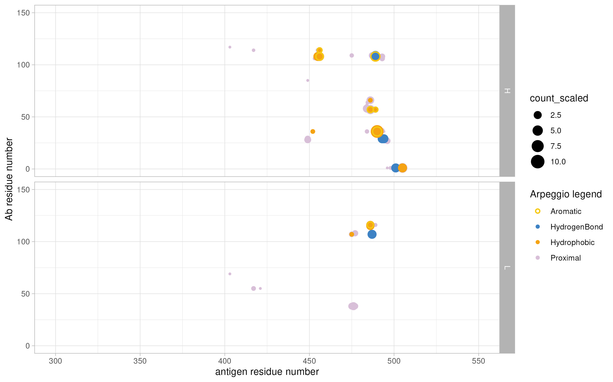
Counts are scaled for visual purposes. Otherwise hydrophobic interactions become dominant. 
Following scales were applied: Hb: 5, Ionic: 2 , Proximal - 0.2; Hydrophobic: 1 

Go to the [interactive plot](feature_contacts_residue_contactplot.html) and hover over the points to find interacting residue pairs.

———————————————————————————————————————————

##### MIF per chain boxplot

```{r}

# new plot (interactions not ranked), in accordance with Arpeggio output

feature_contacts_boxplot_sum_pre.tib <- feature_contacts.tib %>% dplyr::mutate(., scaling = case_when(name == "Proximal" ~ 0.2, TRUE ~ 1)) %>% dplyr::mutate(., count_scaled = sumcount*scaling) %>% dplyr::group_by(., obj, arpeggio, chain1, name) %>% dplyr::summarize(., sumcount=sum(sumcount)) %>% left_join(., arpeggio_assign_color) %>% dplyr::filter(., priority < "f") %>% dplyr::select(., !contains("empty")) 

feature_contacts_boxplot_sum.tib <- feature_contacts_boxplot_sum_pre.tib %>% ggplot(data = ., aes(x=chain1, y = sumcount, colour=PIC_type), fill=NA, linewidth=1, position="identity") + 
  geom_col(data = . %>% dplyr::filter(., filled == "Y"), aes(x=chain1, y = sumcount, fill=PIC_type), colour = "black", linewidth=0.5, position="identity") +
  geom_col(data = . %>% dplyr::filter(., filled == "N"), aes(x=chain1, y = sumcount, colour=PIC_type), fill=NA, linewidth=1, position="identity") +
  scale_fill_manual(values = arpeggio_assign_color_col, "Arpeggio legend") +
  scale_colour_manual(values = arpeggio_assign_color_col, "Arpeggio legend") +
  theme_light() +
  #theme(legend.position = "none") +
  facet_grid(facetPIC ~ obj, scales = "free_y")
#print(filelistdata_molprob_int_sum_ligres2_boxplot.tib)
  ggsave(file="feature_contacts_boxplot_sum.jpeg", plot=feature_contacts_boxplot_sum.tib,device="jpeg", width = 90, height = 90, units = c("mm"))
  ggsave(file="feature_contacts_boxplot_sum.ps", plot=feature_contacts_boxplot_sum.tib,device="ps", width = 90, height = 90, units = c("mm"))  

```
———————————————————————————————————————————

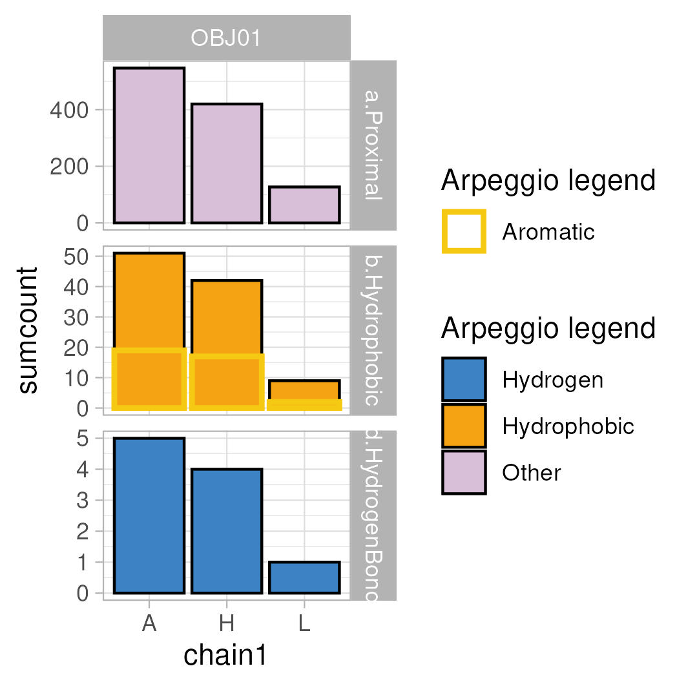{width="307"}
The numbers should add up and correspond to the numbers shown in the Arpeggio result.

———————————————————————————————————————————

##### To visualize in PyMol

Note: Arepeggio also outputs a PyMol session file with all interactions to which you can turn if you suspect other interactions, additional to hydrogen bonds and hydrophobic contacts, to contribute crucially to the interface. 

```{r}
arpeggio_object.trib <- tribble(~obj_arpeggio, ~obj_new,
                           "OBJ01_AB1", "OBJ01_ARP"
                           )

generate_arpeggio_contacts_f <- function(data, arpeggio_sel){
  data_in <- data %>% dplyr::filter(., arpeggio == {{arpeggio_sel}} )
  data_proximal <- data_in %>% dplyr::filter(., name == "Proximal") %>% dplyr::mutate(., rowid = row_number())  %>% dplyr::mutate(., cmd = paste("distance ", obj_arpeggio, "_ prox_", rowid, ", ",selection1, ", ", selection2, ";", sep ="")) 
  data_hydrophobic <- data_in %>% dplyr::filter(., name == "Aromatic" | name == "Hydrophobic") %>% dplyr::mutate(., rowid = row_number()) %>% dplyr::mutate(., rowid = row_number()) %>% dplyr::mutate(., cmd = paste("distance ", obj_arpeggio,"_hphobic_", rowid, ", " ,selection1, ", ", selection2, sep ="") )
  data_hb <- data_in %>% dplyr::filter(., name == "HydrogenBond" | name == "Ionic") %>% dplyr::mutate(., rowid = row_number()) %>% dplyr::mutate(., cmd = paste("distance ", obj_arpeggio,"_hbond_", chain1, number1, chain2, number2, "_", rowid, ", " ,selection1, ", ", selection2, sep ="") )
  data_out <- data_proximal %>% bind_rows(., data_hydrophobic) %>% bind_rows(., data_hb) #%>% dplyr::select(., name, cmd)
  return(data_out)
}

tune_arpeggio_contacts_f <- function(data){
  data_out <- data %>% dplyr::select(., c("obj_arpeggio", "chain1", "number1", "chain2", "number2")) %>% unite(., "chainnum1", c("chain1", "number1"), sep="_") %>% unite(., "chainnum2", c("chain2", "number2"), sep="_") %>% pivot_longer(., cols=c("chainnum1", "chainnum2")) %>% dplyr::select(., !c("name")) %>% group_by(., obj_arpeggio) %>% dplyr::reframe(., res_sel = unique(value)) %>% separate(., "res_sel", into = c("chain", "resi"), sep="_") %>% dplyr::mutate(., cmd_resi = paste("(chain ", chain, " and resi ", resi,")", sep="")) %>% dplyr::select(., !c("chain", "resi")) %>% dplyr::reframe(., obj_arpeggio = unique(obj_arpeggio), cmd_resi = paste(cmd_resi, collapse = " or ")) %>% left_join(., arpeggio_object.trib) %>% dplyr::mutate(., cmd = paste("select ", obj_new, "_show, ", obj_new, " and (", cmd_resi, ")", sep="")) %>% dplyr::select(., c("cmd"))
  return(data_out)
}

pdbsum_filelist_atomlevel_pre.pyscript <- pdbsum_filelist_atomlevel.tib %>% separate(., obj_arpeggio, into=c("obj", "arpeggio"), sep="_", remove=FALSE) %>% ungroup() %>% dplyr::mutate(., selection1 = paste(obj, " and ", id1, sep =""), selection2 = paste(obj, " and ", id2, sep ="")) %>% dplyr::mutate(., arpeggio_sel = arpeggio) %>% group_by(., obj, arpeggio_sel) %>% nest() %>% dplyr::mutate(., arp_sorted = purrr::pmap(list(data, arpeggio_sel), generate_arpeggio_contacts_f)) 

pdbsum_filelist_atomlevel.pyscript <- pdbsum_filelist_atomlevel_pre.pyscript %>% dplyr::mutate(., filename = paste("./pyscripts/", obj, "_", arpeggio_sel, ".pml", sep ="")) %>% dplyr::mutate(., arp_filtered = purrr::map(arp_sorted, ~dplyr::filter(., name != "Proximal"))) %>% dplyr::mutate(., cmd_sel = purrr::map(arp_filtered, ~dplyr::select(., cmd)))

pwalk(list(pdbsum_filelist_atomlevel.pyscript$cmd_sel, pdbsum_filelist_atomlevel.pyscript$filename), write_csv_pymol_f)

pdbsum_filelist_tune.pyscript <- pdbsum_filelist_atomlevel.pyscript %>% dplyr::select(., !c("filename", "cmd_sel")) %>% dplyr::mutate(., cmd_sel = purrr::pmap(list(arp_filtered), tune_arpeggio_contacts_f)) %>% dplyr::mutate(., filename = paste("./pyscripts/", obj, "_", arpeggio_sel, "_tune.pml", sep =""))

pwalk(list(pdbsum_filelist_tune.pyscript$cmd_sel, pdbsum_filelist_tune.pyscript$filename), write_csv_pymol_f)

```

#### To show Arpeggio interface table

```{r output=TRUE}
pdbsum_filelist_atomlevel.stats <- pdbsum_filelist_atomlevel.tib %>% dplyr::select(., obj_arpeggio, id1, id2, number1, number2, name, name_cor) %>% dplyr::filter(., name_cor != "Proximal")

datatable(pdbsum_filelist_atomlevel.stats, filter = 'top') 
datatable(pdbsum_filelist_atomlevel.stats, filter = 'top') %>% saveWidget(., file = "table_arp_stats.html", selfcontained = TRUE)
```
The the PyMol script can be continued to scene_012 in order to visualize the hydrophobic and H bond contacts on the focus region.

———————————————————————————————————————————
{width="307"}

———————————————————————————————————————————
# Export some plots for combining them.

```{r}
saveRDS(pisa_ligand_plot_2_pre.tib, file="./pisa_ligand_plot_2_pre.rds")
saveRDS(feature_contacts_boxplot_sum_pre.tib, file="./feature_contacts_boxplot_sum_pre.rds")
saveRDS(feature_contacts_residue_contactplot_pre.tib, file="./feature_contacts_residue_contactplot_pre.rds")
saveRDS(pisa_ligand_plot_1_pre.tib, file="./pisa_ligand_plot_1_pre.rds")
```

# Additional PyMol script content
The PyMol script `Ab321_map.pml` shows the commands to obtain the volume representation shown in Fig. 2 of the manuscript.
Note: The downloaded map `emd-56019.map` needs to be superimposed on the Ab117 structure. The best way to do this is to use the matchmaker tool in ChimeraX, align the H/L chains (Ab321 as mobile, Ab117 as reference) and let the map be fitted along with the superimposition. The map can then be resampled on the grid of the Ab117 map. 
———————————————————————————————————————————
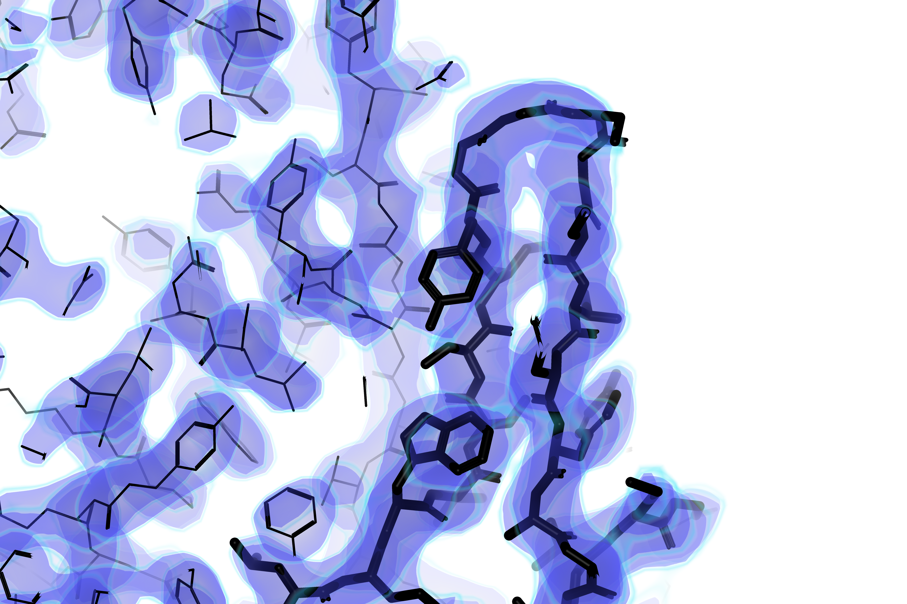{width="307"}

———————————————————————————————————————————


The `echo: false` option disables the printing of code (only output is displayed).
