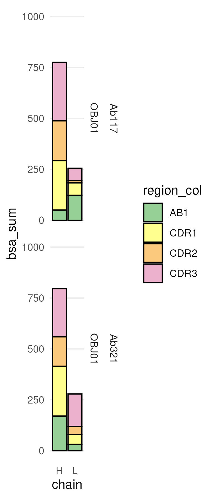
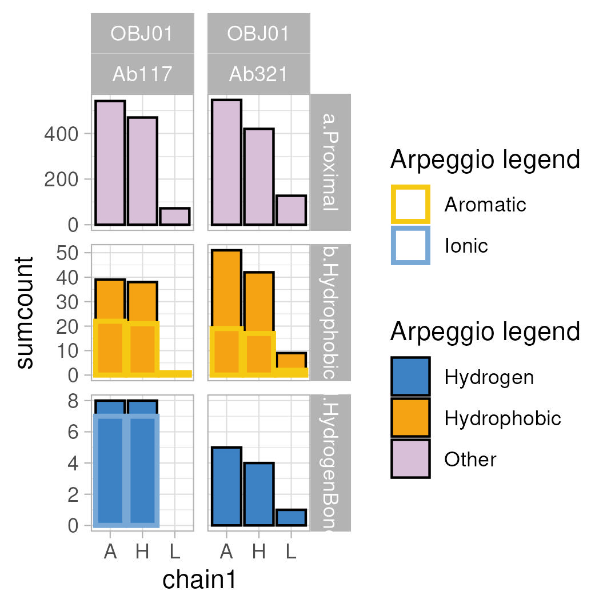
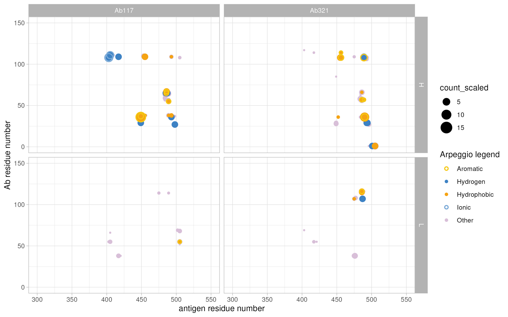

# Custom visualization of Ab/antigen interactions by tidying PISA and Arpeggio outputs in R and PyMol

The auxiliary scripts [NBIS_M_Ohlin_2411_Ab321](NBIS_M_Ohlin_2411_Ab321/NBIS_M_Ohlin_2411_Ab321.html) and [NBIS_M_Ohlin_2411_Ab117](NBIS_M_Ohlin_2411_Ab117/NBIS_M_Ohlin_2411_Ab117.html) were used to analyze the Ab321/RBD and Ab117/RBD interfaces, as presented in our [publication](), and also compared to the ACE2/RBD interface.

The scripts are work in progress, but provide a framework to analyze and visualize antigen/antibody interactions. If you know R and PyMol you could extend this script to other outputs, also consider AI tools. Or you could also transform this into a more automated solution. [Examples](https://pymolwiki.org/Jupyter) exist for PyMol embedded code/analysis within Jupyter notebooks.

Check the pml files (ASCII text), and copy commands scene-by-scene to move forward in PyMol. A break indicates when it´s time to create output from PISA or Arpeggio webservers. These outputs are imported to create summary boxplot visualizations of interaction surfaces, as well as additional PyMOl scripts used in the main PyMOL session scripts.

The [listselection](https://pymolwiki.org/ListSelection2) and [findseq](https://pymolwiki.org/Findseq) scripts are required for analysis.

The PyMOL commands `OBJ01.pml` can be found in the `PyMOL_session` folder. The PDB `OBJ01_Ab321_aligned.pdb` corresponds to the deposited [PDB: 9TK0](https://www.rcsb.org/structure/9TK0), but is aligned with the Ab117/RBD interface for visualization purposes. The PDB `OBJ00_ACE2_aligned.pdb` corresponds to the deposited [PDB: 7A94](https://www.rcsb.org/structure/7A94) displaying the RBD/ACE2 complex.

Check the text file, and copy commands scene-by-scene to move forward. A break is noted in the script to indicate when it´s time to create output from PISA or Arpeggio webservers. These outputs are imported to create summary boxplot visualizations of interaction surfaces, as well as custom auxiliary PyMol visualization scripts.

The scripts have been tested with these deposited PDB files of the two Abs:

- [Ab117 with PDB code 9IB1](https://www.rcsb.org/structure/9IB1)
- [Ab321 with PDB code 9TK0](https://www.rcsb.org/structure/9TK0); Note: not released yet.
- [ACE2 with PDB code 7A94](https://www.rcsb.org/structure/7A94)

# Setup to run the analysis

This setup was created for an interactive Work in RStudio with a shared renv package management. This analysis was run using Docker/tidyverse.

`sudo docker run -d --name NBIS_M_Ohlin_2411_interface_analysis_PDBdeposited -e PASSWORD=XXX --mount type=bind,src=/media/timschu/tims_data/projects/202411_M_Ohlin_2411/git/NBIS_M_Ohlin_241 1_interface_analysis_PDBdeposited,dst=/home/rstudio/NBIS_M_Ohlin_2411_interface_analysis_PDBdeposited -dit -p 8787:8787 rocker/tidyverse`

and RStudio project files were created in each subfolder.

```         
cp NBIS_M_Ohlin_2411_interface_analysis_PDBdeposited.Rproj NBIS_M_Ohlin_2411_Ab117/NBIS_M_Ohlin_2411_Ab117.Rproj
cp NBIS_M_Ohlin_2411_interface_analysis_PDBdeposited.Rproj NBIS_M_Ohlin_2411_Ab321/NBIS_M_Ohlin_2411_Ab321.Rproj
```

Run the next code chunk to initialize renv and install the packages.

# Shared renv environment

Setting up the folder

Set current wd if needed.

```{r}
setwd("./NBIS_M_Ohlin_2411_interface_analysis_vscoded_mimotopes")
```

You may need to re-install renv (Tools -> Install Packages)

If not yet initialized:

```{r}
# Initialize renv at the root: 
renv::init()
```

If already initialized once, restore:

```{r}
renv::restore()
```

```{r}
# Install all packages needed by both projects
renv::install("tidyverse")
renv::install("xml2")
renv::install("DT")
renv::install("vroom")
renv::install("ggsci")
renv::install("kableExtra")
renv::install("ggforce")
renv::install("egg")
renv::install("ggpubr")
renv::install("datapasta")
renv::install("officer")
renv::install("formattable")
renv::install("bio3d")
renv::install("statip")
renv::install("boot")
renv::install("cluster")
renv::install("htmlwidgets")
renv::install("lattice")
renv::install("MASS")
renv::install("Matrix")
renv::install("mgcv")
renv::install("nlme")
renv::install("nnet")
renv::install("promises")
renv::install("Rcpp")
renv::install("rpart")
renv::install("survival")
renv::install("zip")
renv::install("cowplot")
renv::install("plotly")
renv::install("tidyjson")
renv::install("curl")
# Take a snapshot
renv::snapshot()
```

Make sure you have a `.Rprofile` at the root that activates renv Contents of `.Rprofile`: `source("renv/activate.R")` You also need to create `.Rprofile`files in the subfolders with the content: `source("../renv/activate.R")`

The easiest way to run the analyses in the other folders is to open the `.qmd` files manually and set the working directory to that subfolder, e.g. `setwd("./NBIS_M_Ohlin_2411_Ab117")` Paths can be set relative from where you are currently. The above cmd assumes that you are in the main folder. To get to know the current path `getwd()`

# Keeping Multiple .Rproj Files

combined-site/ ├── combined-site.Rproj \# NEW: Main project ├── \_quarto.yml ├── renv/ ├── renv.lock ├── .Rprofile \# source("renv/activate.R") ├── project-a/ │ ├── project-a.Rproj \# Can keep for reference │ └── \[files\] └── project-b/ ├── project-b.Rproj \# Can keep for reference └── \[files\]

# Combined plots

The combined plots can only be run after analysis of the sub-folders.

## Load libraries

```{r}
library(tidyverse)
library(xml2)
library(DT)
library(vroom)
library(ggsci)
library(kableExtra)
library(ggforce)
library(egg)
library(ggpubr)
library(datapasta)
library(officer)
library(formattable)
library(bio3d)
library(statip)
library(cowplot)
library(plotly)

# Source shared configuration
source("R/shared_config.R")
```

## Load the exported plots to combine them.

```{r}
combine_plots_f <- function(data){
  data_out <- data %>% pivot_wider(., names_from = "sample", values_from="plotted") 
}

plot_list = list.files(path = "./", pattern = "pisa_ligand_plot_2_pre.rds|feature_contacts_boxplot_sum_pre.rds|feature_contacts_residue_contactplot_pre.rds|pisa_ligand_plot_1_pre.rds", recursive = TRUE, include.dirs = TRUE, full.names = TRUE) 

plot_list_all.tib <- as_tibble(plot_list) %>% separate(., value, into = c("dot", "empty", "foldername", "plotname"), sep = "\\/", remove = FALSE) %>% dplyr::select(., !c("dot", "empty")) %>% separate(., foldername, into = c("NBIS", "pre", "Name", "Date", "sample"), sep = "_") %>% dplyr::select(., c("value", "sample", "plotname")) %>% dplyr::mutate(., plottype = str_remove(plotname, "\\.rds")) %>% dplyr::select(., !c("plotname")) %>% dplyr::mutate(., data = purrr::map(value, ~readRDS(.))) %>% dplyr::select(., !c("value")) 

```

### Filter out reference sample

```{r}
plot_list.tib <- plot_list_all.tib %>% dplyr::filter(., sample != "ACE2")
```

### To define coloring schemes

```{r}
# Load region colors from shared config (base palette for this comparison)
region_colors.tib <- get_base_region_colors()
region_colors <- region_colors.tib %>% deframe()

# Load Arpeggio interaction type colors from shared config
yrb <- get_yrb_colors()
arpeggio_assign_color <- build_arpeggio_assign_color()
arpeggio_assign_color_col <- get_arpeggio_assign_color_col(arpeggio_assign_color, key_column = "PIC_type")
```

## The plots

```{r}
pisa_ligand_plot_1.tib <- plot_list.tib %>% dplyr::filter(., plottype == "pisa_ligand_plot_1_pre") %>% unnest(., data) %>% ggplot(data=.) + geom_col(aes(x=chain, y = bsa_sum, fill = region_col), colour="black", size=0.5, position = position_stack(reverse = TRUE)) +
#scale_fill_gradient2("bsa: Å", midpoint = 80, low="lightblue", mid="blue", high="red", space ="Lab") +
  scale_fill_manual(values = region_colors, drop=FALSE) +
  theme_minimal() +
  theme(panel.grid.major.x = element_blank()) +
  #  scale_x_discrete() +
  #theme(legend.position = "none") +
  scale_y_continuous(minor_breaks = NULL) +
  #scale_x_continuous("bsa: Å", breaks = c(0,250, 500)) +
  coord_cartesian(ylim = c(0,1200)) +
  #geom_text( aes(label = res1AA, y = -5), position = position_dodge(0.9), vjust = 0) +
  facet_grid(sample + obj ~ .)
  #print(molprob_filelistdata_int_sum_ligres_area_sum_plot.tib)
  ggsave(file="ggplot_pisa_bsa_1.jpeg", plot=pisa_ligand_plot_1.tib,device="jpeg", width = 65, height = 150, units = c("mm"))
  ggsave(file="ggplot_pisa_bsa_1.ps", plot=pisa_ligand_plot_1.tib,device="ps", width = 65, height = 150, units = c("mm"))

pisa_ligand_plot_2.tib <- plot_list.tib %>% dplyr::filter(., plottype == "pisa_ligand_plot_2_pre") %>% unnest(., data) %>% ggplot(data=.) + geom_col(aes(x=chain, y = bsa_sum, fill = region_col), colour="black", size=0.5, position = position_stack(reverse = TRUE)) +
#scale_fill_gradient2("bsa: Å", midpoint = 80, low="lightblue", mid="blue", high="red", space ="Lab") +
  scale_fill_manual(values = region_colors, drop=FALSE) +
  theme_minimal() +
      theme(panel.grid.major.x = element_blank()) +
  #scale_x_discrete(breaks=NULL) +
  #theme(legend.position = "none") +
  scale_y_continuous(minor_breaks = NULL) +
  #scale_x_continuous("bsa: Å", breaks = c(0,250, 500)) +
  coord_cartesian(ylim = c(0,1000)) +
  #geom_text( aes(label = res1AA, y = -5), position = position_dodge(0.9), vjust = 0) +
  facet_grid(sample + obj ~ .)
  #print(molprob_filelistdata_int_sum_ligres_area_sum_plot.tib)
  ggsave(file="ggplot_pisa_bsa_2.jpeg", plot=pisa_ligand_plot_2.tib,device="jpeg", width = 65, height = 150, units = c("mm"))
  ggsave(file="ggplot_pisa_bsa_2.ps", plot=pisa_ligand_plot_2.tib,device="ps", width = 65, height = 150, units = c("mm"))
  
feature_contacts_boxplot_sum.tib <- plot_list.tib %>% dplyr::filter(., plottype == "feature_contacts_boxplot_sum_pre") %>% unnest(., data) %>% ggplot(data = ., aes(x=chain1, y = sumcount, colour=PIC_type), fill=NA, linewidth=1, position="identity") + 
  geom_col(data = . %>% dplyr::filter(., filled == "Y"), aes(x=chain1, y = sumcount, fill=PIC_type), colour = "black", linewidth=0.5, position="identity") +
  geom_col(data = . %>% dplyr::filter(., filled == "N"), aes(x=chain1, y = sumcount, colour=PIC_type), fill=NA, linewidth=1, position="identity") +
  #geom_col(data = . %>% dplyr::filter(.), aes(x=chain1, y = sumcount, colour=name)) +
  #scale_size_area() +
  #scale_x_continuous("residue number") +
  #scale_y_continuous("interaction count") +
  #coord_cartesian(xlim = c(0,15)) +
  scale_fill_manual(values = arpeggio_assign_color_col, "Arpeggio legend") +
  scale_colour_manual(values = arpeggio_assign_color_col, "Arpeggio legend") +
  theme_light() +
  #theme(legend.position = "none") +
  facet_grid(facetPIC ~ obj + sample, scales = "free_y")
#print(filelistdata_molprob_int_sum_ligres2_boxplot.tib)
  ggsave(file="feature_contacts_boxplot_sum.jpeg", plot=feature_contacts_boxplot_sum.tib,device="jpeg", width = 90, height = 90, units = c("mm"))
  ggsave(file="feature_contacts_boxplot_sum.ps", plot=feature_contacts_boxplot_sum.tib,device="ps", width = 90, height = 90, units = c("mm"))    
  
feature_contacts_residue_contactplot.tib <- plot_list.tib %>% dplyr::filter(., plottype == "feature_contacts_residue_contactplot_pre") %>% unnest(., data) %>% ggplot() + 
  geom_point(data = . %>% dplyr::filter(., name == "Proximal", filled == "Y"), aes(x=number2, y = number1, color=PIC_type, size = count_scaled)) +
  geom_point(data = . %>% dplyr::filter(., name != "Proximal", filled == "Y"), aes(x=number2, y = number1, color=PIC_type, size = count_scaled)) +
  geom_point(data = . %>% dplyr::filter(., name != "Proximal", filled == "N"), aes(x=number2, y = number1, color=PIC_type, size = count_scaled), shape = 1, stroke = 1) +
  scale_size_area() +
  scale_x_continuous("antigen residue number") +
  scale_y_continuous("Ab residue number") +
  coord_cartesian(xlim = c(300, 550), ylim = c(0, 150)) +
  #coord_cartesian(xlim = c(0,15)) +
  scale_color_manual(values = arpeggio_assign_color_col, "Arpeggio legend") +
  theme_light() +
  #theme(legend.position = "none") +
  facet_grid(chain1 ~ sample, scales = "free_x")
#print(filelistdata_molprob_int_sum_ligres2_boxplot.tib)
  ggsave(file="ggplot_feature_contacts_residue_contmap.jpeg", plot=feature_contacts_residue_contactplot.tib,device="jpeg", width = 240, height = 150, units = c("mm"))
  ggsave(file="ggplot_feature_contacts_residue_contmap.ps", plot=feature_contacts_residue_contactplot.tib,device="ps", width = 240, height = 150, units = c("mm"))
  
feature_contacts_residue_contactplot.plotly <- ggplotly(feature_contacts_residue_contactplot.tib)  
htmlwidgets::saveWidget(feature_contacts_residue_contactplot.plotly, "feature_contacts_residue_contactplot.html")

```

### MIF per chain boxplot

——————————————————————————————————————————— {width="50%"} ———————————————————————————————————————————

### Arpeggio summary plot

———————————————————————————————————————————  ———————————————————————————————————————————

### Arpeggio contact map

#### static

———————————————————————————————————————————  ———————————————————————————————————————————

#### interactive

——————————————————————————————————————————— Go to the [interactive plot](feature_contacts_residue_contactplot.html) and hover over the points to find interacting residue pairs. ———————————————————————————————————————————

———————————————————————————————————————————
